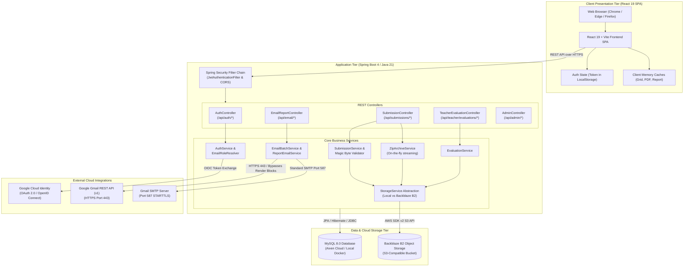
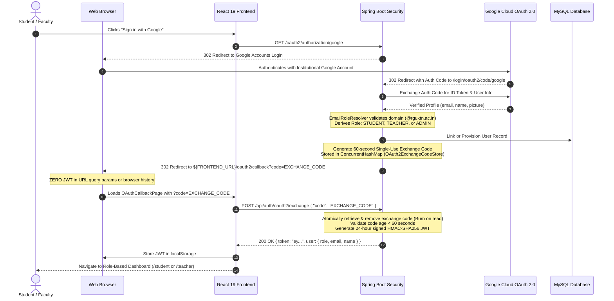
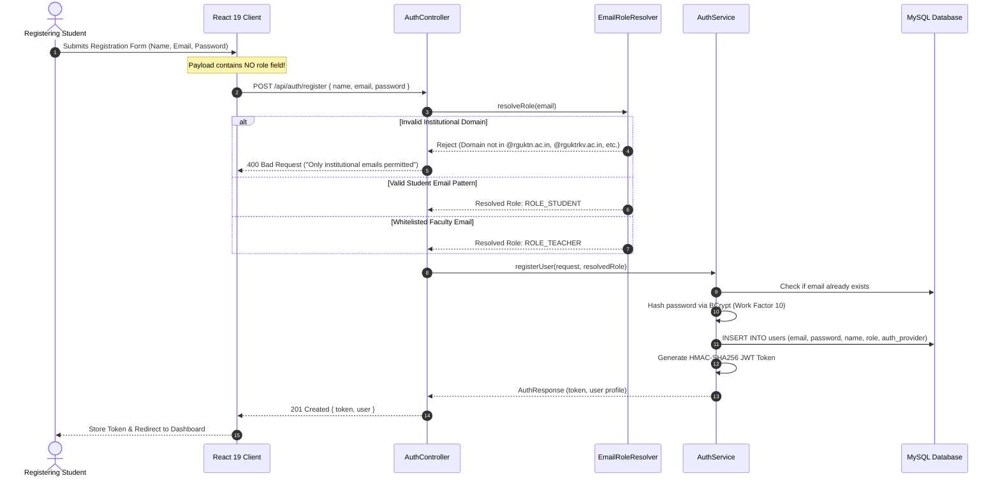
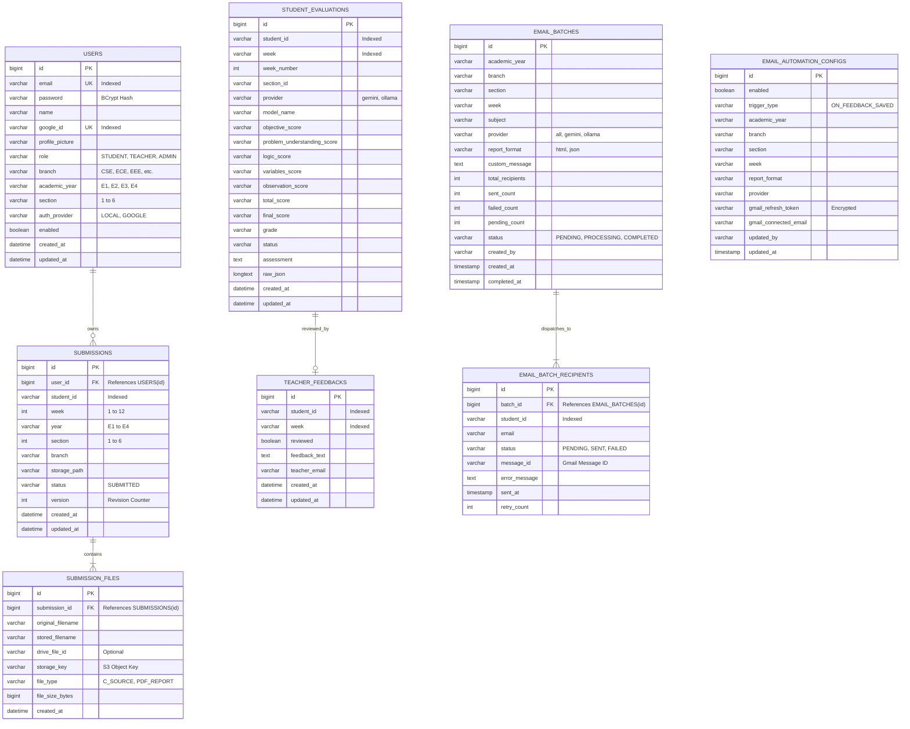
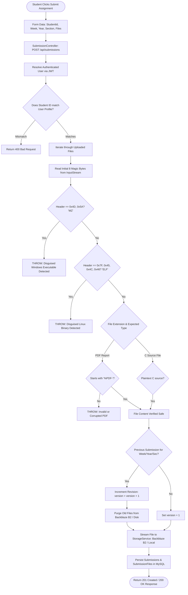
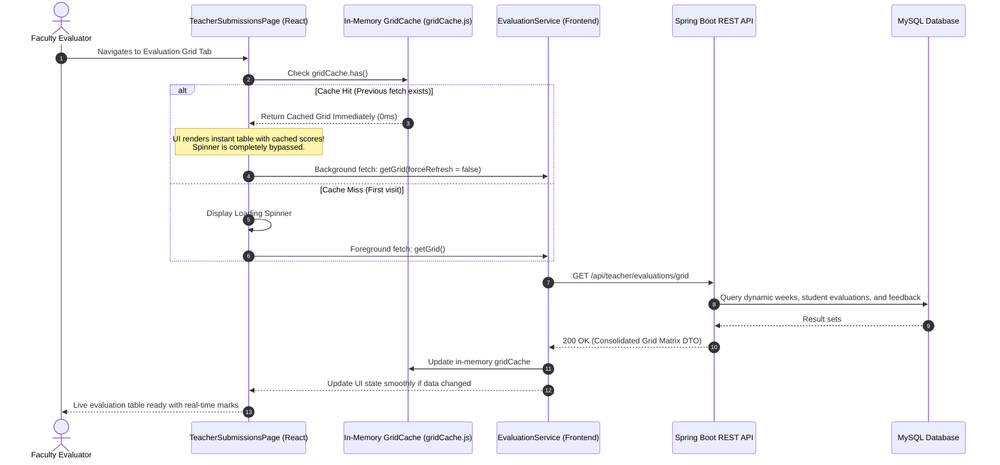
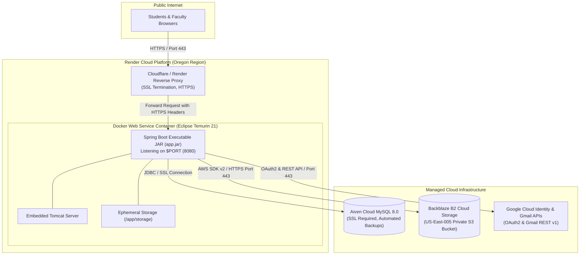

# System Architecture & Technical Diagrams: Institutional Evaluation Portal

---

## 1. High-Level System Architecture

This diagram illustrates the global architecture of AuthPortal, showing the relationship between client web browsers, the Spring Boot application tier, database persistence, cloud object storage, and external Google Cloud APIs.



---

## 2. Authentication Flow 1: Google OAuth 2.0 with Zero-JWT in URL

This sequence diagram depicts how AuthPortal prevents token leakage in browser history, proxy logs, and HTTP Referer headers using an ephemeral single-use 60-second exchange code.



---

## 3. Authentication Flow 2: Local Registration & Login (Server-Enforced RBAC)

This diagram details the local email/password registration and login process, illustrating how client-side privilege escalation is completely blocked.



---

## 4. Database Entity-Relationship (ER) Diagram

This diagram visualizes all 8 tables, primary keys, foreign keys, and indexes managed across Flyway migrations V1 to V12.



---

## 5. Student Submission & Deep Magic Byte Validation Flow

This diagram illustrates how uploaded files are validated against malicious binaries before being safely persisted to cloud storage.



---

## 6. On-The-Fly Streaming ZIP Archive Generation Flow

This diagram shows how teachers can download entire cohorts of lab submissions as structured ZIP archives without exhausting server memory or disk storage.

```mermaid
sequenceDiagram
    autonumber
    actor Teacher as Lab Instructor
    participant React as React 19 Frontend
    participant Controller as SubmissionController
    participant ZipService as ZipArchiveService
    participant Storage as StorageService (Backblaze B2)
    participant ClientStream as HTTP Streaming Response

    Teacher->>React: Clicks "Download Section Submissions (ZIP)"
    React->>Controller: GET /api/submissions/teacher/download-zip?week=1&year=E1&section=2
    Controller->>ZipService: streamSubmissionsZip(week, year, section, response)
    
    Note over ZipService: Wrap HttpServletResponse in ZipOutputStream<br/>Set Header: Content-Disposition: attachment; filename="week-1-sec-2.zip"
    
    ZipService->>ZipService: Query DB for all submissions matching Week 1, E1, Section 2
    
    loop For Every Student Submission
        Note over ZipService: Create ZIP Directory: "week-1-sec-2/{studentId}/"
        loop For Every File (.c and .pdf)
            ZipService->>ZipService: PutNextEntry("week-1-sec-2/{studentId}/{originalFilename}")
            ZipService->>Storage: loadFileAsStream(storageKey)
            Storage-->>ZipService: InputStream (Direct S3 / Disk Stream)
            ZipService->>ClientStream: Copy InputStream bytes directly into ZipOutputStream
            Note over ClientStream: Streamed chunk-by-chunk to browser<br/>ZERO staging on server hard drive!
            ZipService->>ZipService: CloseEntry()
        end
    end
    
    ZipService->>ClientStream: Finish & Flush ZipOutputStream
    ClientStream-->>Teacher: Browser completes download of week-1-sec-2.zip
```

---

## 7. Dual-Engine Email Dispatcher Architecture

This diagram demonstrates how AuthPortal guarantees email delivery across restricted cloud environments (such as Render Free Tier) by intelligently toggling between Gmail REST API and SMTP.

```mermaid
flowchart TD
    Trigger([Email Send Requested\nIndividual / Batch / Test]) --> Router[ReportEmailService / EmailBatchService]
    Router --> CheckEngine{Is Gmail REST API configured?\n(Refresh Token Present in DB/Env?)}
    
    subgraph RESTEngine["Engine 1: Google Gmail REST API (v1) — Cloud Resilient"]
        CheckEngine -->|YES: Token Present| FetchToken[Check In-Memory Access Token Cache]
        FetchToken --> CheckExpire{Is Access Token Expired?}
        CheckExpire -->|Yes| RefreshOAuth[POST https://oauth2.googleapis.com/token\nExchange Refresh Token for new Access Token]
        CheckExpire -->|No| UseCached[Use Cached Access Token]
        RefreshOAuth --> BuildMime[Construct RFC 2822 MIME Message\n(HTML body + Attachments)]
        UseCached --> BuildMime
        BuildMime --> Base64Encode[Base64URL Encode Raw Message]
        Base64Encode --> RestCall[POST https://gmail.googleapis.com/gmail/v1/users/me/messages/send\nAuthorization: Bearer AccessToken\nPort 443 HTTPS]
        RestCall --> RenderPass[Bypasses Render Outbound SMTP Port 587/25 Blocks!]
    end

    subgraph SMTPEngine["Engine 2: Gmail SMTP — Standard Delivery"]
        CheckEngine -->|NO: No Token| FallbackSMTP[Initialize JavaMailSender]
        FallbackSMTP --> ConnectSMTP[Connect to smtp.gmail.com:587\nSTARTTLS Authentication]
        ConnectSMTP --> SendSMTP[Dispatch MIME Message via SMTP Protocol]
    end

    RenderPass --> UpdateStatus[Update EmailBatchRecipient Record in MySQL]
    SendSMTP --> UpdateStatus
    UpdateStatus --> Complete([Delivery Recorded: SENT with Message-ID or FAILED with Error Log])
```

---

## 8. Teacher Evaluation Grid & SWR Caching Flow

This diagram illustrates how the frontend achieves instantaneous navigation and sub-second load times using Stale-While-Revalidate (SWR) in-memory caching.



---

## 9. Production Deployment Architecture (Docker & Cloud PaaS)

This diagram shows how the system is deployed in production across Render Web Services, Aiven Cloud MySQL, and Backblaze B2.


