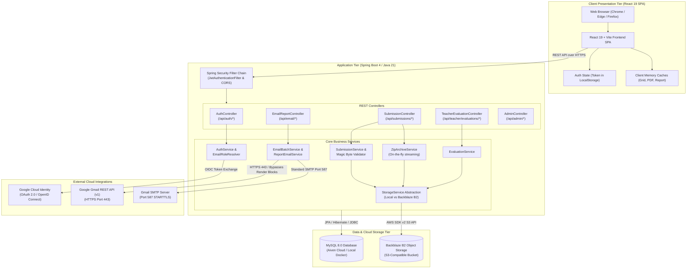
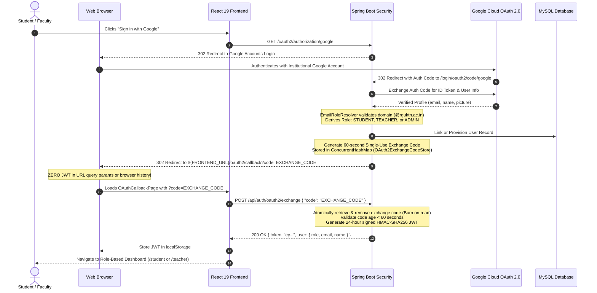
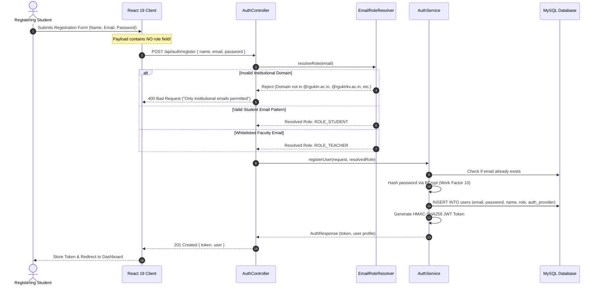
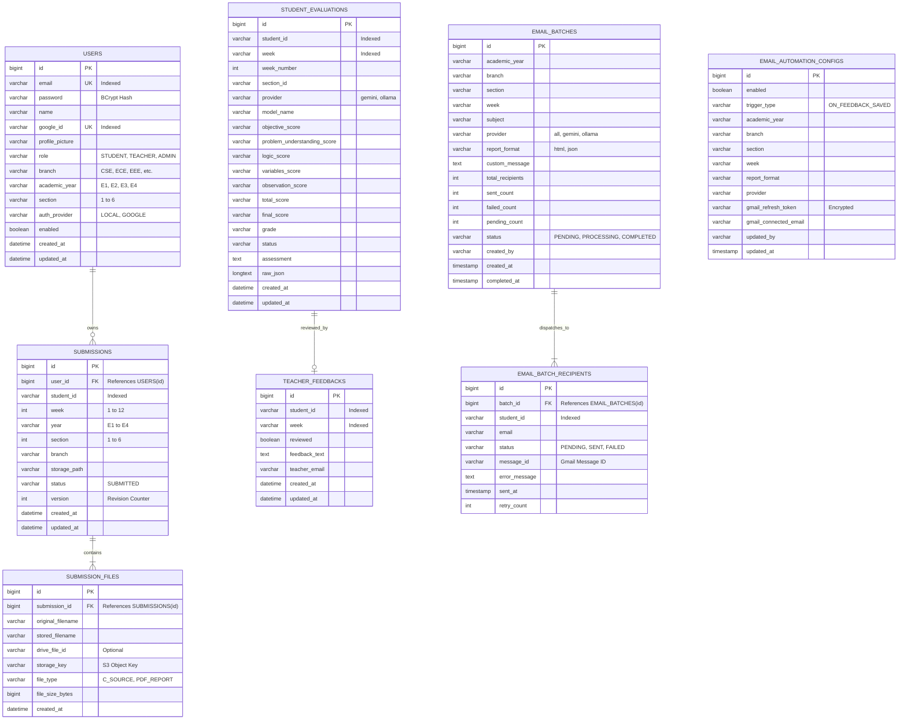
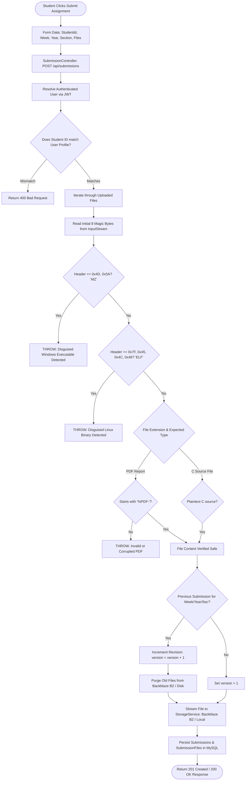
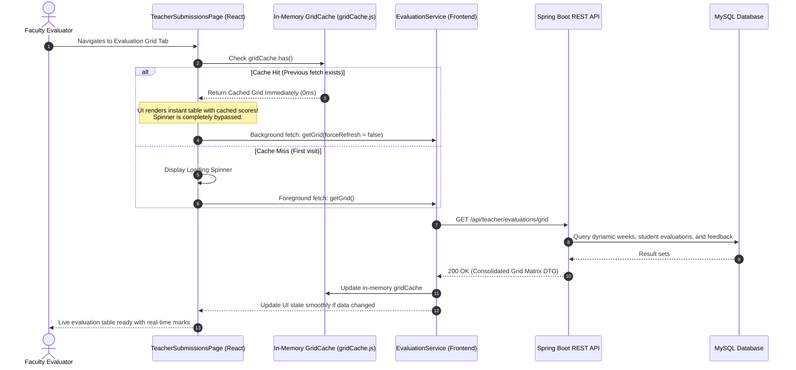
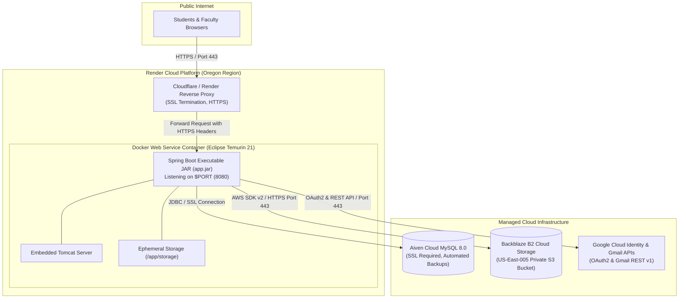

# RGUKT AuthPortal: Master Technical Documentation, Architecture & PowerPoint Presentation Kit

---

## Master Table of Contents

1. [Executive Summary & Academic Abstract](#1-executive-summary--academic-abstract)
2. [Institutional Context & University Ecosystem](#2-institutional-context--university-ecosystem)
3. [Problem Statement & Existing System Deficiencies](#3-problem-statement--existing-system-deficiencies)
4. [Proposed System & Core Innovations](#4-proposed-system--core-innovations)
5. [Project Objectives & Scope](#5-project-objectives--scope)
6. [Functional & Non-Functional Requirements](#6-functional--non-functional-requirements)
7. [Complete Technology Stack & Justification](#7-complete-technology-stack--justification)
8. [System Architecture & Production-Accurate Mermaid Diagrams](#8-system-architecture--production-accurate-mermaid-diagrams)
   - 8.1 High-Level System Architecture
   - 8.2 Google OAuth 2.0 with Zero-JWT in URL
   - 8.3 Local Registration & Server-Enforced RBAC
   - 8.4 Relational Database Entity-Relationship (ER) Diagram
   - 8.5 Student Submission & Deep Magic Byte Validation Flow
   - 8.6 On-The-Fly Streaming ZIP Generation Flow
   - 8.7 Dual-Engine Cloud-Resilient Mailer Flow
   - 8.8 Teacher Evaluation Grid & SWR Caching Flow
   - 8.9 Production Docker & Cloud PaaS Architecture
9. [Database Schema & Sequential Flyway Migrations (V1–V12)](#9-database-schema--sequential-flyway-migrations-v1v12)
10. [Comprehensive REST API Reference](#10-comprehensive-rest-api-reference)
11. [Module-Wise Deep Dive](#11-module-wise-deep-dive)
    - 11.1 Authentication & Role Resolution Module
    - 11.2 Student Laboratory Submission Engine
    - 11.3 Pluggable Cloud Object Storage Subsystem
    - 11.4 Teacher Evaluation Grid & Multi-Provider Ingestion
    - 11.5 Cloud-Resilient Dual-Engine Mail Notification Subsystem
    - 11.6 Administrative Governance & Safety Controls
12. [Critical Algorithms & Core Business Logic](#12-critical-algorithms--core-business-logic)
13. [Engineering Challenges Overcome & Solutions](#13-engineering-challenges-overcome--solutions)
14. [Testing Approach & Verification (121 Automated Tests)](#14-testing-approach--verification-121-automated-tests)
15. [PowerPoint Presentation: Slide-by-Slide Deck (15 Slides)](#15-powerpoint-presentation-slide-by-slide-deck-15-slides)
16. [Presenter Notes & Speaking Scripts (1-Min, 3-Min, 5-Min, Slide-by-Slide)](#16-presenter-notes--speaking-scripts-1-min-3-min-5-min-slide-by-slide)
17. [Comprehensive Technical Viva Question Bank (85 Questions & Answers)](#17-comprehensive-technical-viva-question-bank-85-questions--answers)
18. [Screenshot Collection & Visual Proof Guide (12 Key Screens)](#18-screenshot-collection--visual-proof-guide-12-key-screens)
19. [Live Project Demonstration Guide (5 Phases & Contingency)](#19-live-project-demonstration-guide-5-phases--contingency)
20. [Production Deployment Guide & Conclusion](#20-production-deployment-guide--conclusion)

---

# 1. Executive Summary & Academic Abstract

### 1.1 Project Metadata
- **Project Title**: Institutional Authentication, Laboratory Submission Management & Academic Evaluation Portal (AuthPortal)
- **Primary Domain**: Cloud Computing, Enterprise Web Systems & Educational Technology (EdTech)
- **Sub-Domains**: Role-Based Access Control (RBAC), Secure Cloud Storage, Automated Evaluation Pipelines, Resilient Batch Mail Delivery
- **Target Institution**: Rajiv Gandhi University of Knowledge Technologies (RGUKT) — AP Campuses (Nuzvid, RK Valley, Ongole, Srikakulam)
- **Target User Scale**: 20,000+ Undergraduate Engineering Students, Laboratory Faculty/Instructors, and Department Administrators
- **Backend Architecture**: Java 21 LTS, Spring Boot 4.0.8, Spring Security 6, Spring Data JPA, Flyway, AWS SDK v2
- **Frontend Architecture**: React 19, Vite 6, React Router DOM 7, Vanilla CSS Design System, KaTeX, PDF.js
- **Database & Storage**: MySQL 8.0 (Aiven Cloud / Docker), Backblaze B2 S3-Compatible Object Store

### 1.2 Academic Abstract
In collegiate engineering education, continuous laboratory evaluation presents significant administrative, pedagogical, and security challenges. Conventional evaluation workflows rely heavily on disparate tools—such as generic Google Forms, insecure file sharing, or ad-hoc email submissions—which lack automated institutional identity verification, revision auditing, structured evaluation ingestion, and scalable report distribution. Furthermore, unrestricted file upload portals often introduce critical security vulnerabilities, including executable payload injection, cross-student privilege escalation, and token exposure in browser navigation histories.

To address these systemic challenges, this project presents **AuthPortal**, a robust, production-ready, full-stack institutional platform engineered using **Java 21**, **Spring Boot 4**, **Spring Security 6**, and **React 19**. The platform establishes a **Zero-Trust Institutional Authentication Framework** that couples Google OAuth 2.0 / OpenID Connect with strict server-side institutional email parsing (`^[A-Za-z]\d{6}@(rguktn|rguktrkv|rguktong|rguktsklm)\.ac\.in`). This eliminates client-side role forgery and prevents OAuth token leakage via an ephemeral single-use authorization code exchange mechanism (**Zero-JWT in URL**).

The system integrates a hardened **Student Laboratory Submission Engine** featuring multi-byte magic header inspection to block disguised Windows PE, Linux ELF, and Mach-O executables while facilitating versioned source code (`.c`) and lab report (`.pdf`) submissions. For faculty, AuthPortal offers an **Interactive Multi-Week Evaluation Grid** capable of ingesting structured evaluation outputs from both cloud-native (Google Gemini) and local (Ollama) artificial intelligence evaluation models alongside standard tabular formats. Faculty can review original student PDFs inline via PDF.js, append qualitative feedback, and adjust quantitative marks.

Crucially, to overcome cloud deployment constraints where platforms like Render block standard SMTP ports (25, 465, 587) on free tiers, AuthPortal implements a **Dual-Engine Notification Architecture**. The system seamlessly alternates between standard **Gmail SMTP** and direct **Google Gmail REST API (v1)** invocation over HTTPS port 443 using an OAuth2 refresh token. Additionally, the platform features a pluggable storage subsystem abstracting local disk and **Backblaze B2 S3** storage, accompanied by an on-the-fly streaming ZIP aggregation engine for instant section-wide lab downloads. The platform has been validated through 121 automated integration and unit test suites, demonstrating high reliability, enterprise-grade security, and production readiness.

---

# 2. Institutional Context & University Ecosystem

The Rajiv Gandhi University of Knowledge Technologies (RGUKT) in Andhra Pradesh educates over 20,000 meritorious students across four autonomous campuses:
1. **RGUKT Nuzvid Campus (`@rguktn.ac.in`)**
2. **RGUKT RK Valley / Idupulapaya Campus (`@rguktrkv.ac.in`)**
3. **RGUKT Ongole Campus (`@rguktong.ac.in`)**
4. **RGUKT Srikakulam Campus (`@rguktsklm.ac.in`)**
5. **RGUKT Central / Alternate Google Domain (`@rgukt.in`)**

Every academic semester, students across disciplines (CSE, ECE, EEE, ME, CE, CHE, MME) complete weekly programming laboratories spanning **12 structured weeks**. With cohorts averaging 1,000+ students per year-level per campus, instructors evaluate and process over 12,000 individual lab submissions each semester. AuthPortal was tailored specifically to automate this institutional lifecycle while enforcing collegiate governance rules.

---

# 3. Problem Statement & Existing System Deficiencies

Traditional collegiate laboratory management suffers from five systemic vulnerabilities:
1. **Identity & Privilege Escalation Risks**: Generic registration portals permit users to select their own roles (`STUDENT`, `TEACHER`, `ADMIN`). Students registering with personal `@gmail.com` accounts impede identity verification and bypass university access controls.
2. **Malicious Executable Upload Threats**: Basic frontend file extension checks (e.g. Checking for `.c` or `.pdf`) are trivial to bypass. Inquisitive or malicious students can rename compiled Windows PE (`.exe`) or Linux ELF binaries to `.c`, introducing severe malware risks to institutional servers and faculty grading laptops.
3. **OAuth Token Exposure in URLs**: Standard Single Page Application (SPA) OAuth patterns redirect back to the client with the JWT in the URL query string or hash fragment (`https://frontend/?token=ey...`). This leaves sensitive credentials exposed in browser history, proxy server logs, and HTTP `Referer` headers.
4. **Cloud Network Filtering on Outbound SMTP**: Modern cloud hosting platforms (such as Render Free Tier and default AWS security groups) strictly block outbound traffic on SMTP ports 25, 465, and 587 to prevent spam. Consequently, standard JavaMailSender configurations fail with socket connection timeouts.
5. **Evaluation Silos & Feedback Delays**: Evaluated lab reports generated by automated grading rubrics or AI evaluation pipelines remain trapped on faculty machines in offline spreadsheets, depriving students of timely, actionable feedback before their next laboratory experiment.

---

# 4. Proposed System & Core Innovations

AuthPortal resolves these deficiencies through six foundational innovations:

```text
+----------------------------------------------------------------------------------------------------+
|                                    AUTHPORTAL CORE INNOVATIONS                                     |
+----------------------------------------------------------------------------------------------------+
|  1. Zero-JWT in URL Redirection                                                                    |
|     Issues an ephemeral single-use 60s exchange code on Google OAuth redirect to eliminate         |
|     JWT leakage in browser history, proxy logs, and HTTP Referer headers.                          |
+----------------------------------------------------------------------------------------------------+
|  2. Server-Enforced Role Resolution                                                                |
|     Roles are strictly determined by parsing institutional email domains and student ID regex.     |
|     Clients can never self-assign or elevate privileges during registration or login.              |
+----------------------------------------------------------------------------------------------------+
|  3. Deep Magic-Byte Executable Blocker                                                             |
|     Inspects raw initial file bytes to reject Windows PE (MZ), Linux ELF, and Mach-O binaries     |
|     even if students maliciously rename binaries to .c or .pdf.                                    |
+----------------------------------------------------------------------------------------------------+
|  4. Dual-Engine Cloud-Resilient Mailer                                                             |
|     Implements both standard SMTP (port 587) and Google Gmail REST API over HTTPS (port 443).     |
|     Bypasses cloud provider firewall restrictions on outbound SMTP ports (Render Free Tier).       |
+----------------------------------------------------------------------------------------------------+
|  5. Pluggable Zero-Staging Cloud Storage                                                           |
|     Decoupled storage service supporting Local Disk and Backblaze B2 (AWS SDK v2). Streams        |
|     files directly to/from client memory without saving temporary files to ephemeral disks.       |
+----------------------------------------------------------------------------------------------------+
|  6. Dynamic Multi-Week Evaluation Grid & AI Multi-Provider Support                                 |
|     Aggregates dynamic weeks and students in a single query; seamlessly supports AI evaluations    |
|     generated by Google Gemini and Ollama with LaTeX KaTeX rendering.                              |
+----------------------------------------------------------------------------------------------------+
```

---

# 5. Project Objectives & Scope

### 5.1 Project Objectives
1. Implement a high-performance REST backend in **Java 21** and **Spring Boot 4.0.8** following layered enterprise standards.
2. Build an intuitive Single Page Application in **React 19** and **Vite 6** styled with an accessible CSS design system.
3. Enforce dual authentication: Google OAuth 2.0 / OpenID Connect and local BCrypt password hashing.
4. Prevent OAuth token leakage via an ephemeral single-use exchange code store (60s TTL).
5. Enforce server-side role resolution based on university email domains (`@rguktn.ac.in`).
6. Provide a secure lab submission pipeline supporting multi-file uploads (`.c` + `.pdf`) with magic byte validation and revision versioning (`v1 -> v2`).
7. Implement a pluggable storage subsystem supporting local disk and **Backblaze B2 S3 Object Storage**.
8. Deliver an interactive Teacher Evaluation Grid supporting dynamic multi-week column generation, student search, and inline PDF viewing via PDF.js.
9. Ingest multi-provider AI evaluation reports (Google Gemini, Ollama) with LaTeX mathematical formula rendering via KaTeX.
10. Engineer a cloud-resilient dual-engine mailer: standard **Gmail SMTP** and **Gmail REST API (v1)** over HTTPS Port 443.
11. Implement an Administrative Console for institutional KPI tracking, user lifecycle management, and role safety guards.
12. Establish comprehensive test coverage via 121 automated backend tests.

### 5.2 Functional Boundaries
- **In-Scope**: Authentication, authorization, file validation, S3 storage abstraction, streaming ZIP downloads, dynamic evaluation grid, multi-provider report ingestion, dual-engine email batching, admin controls, 12 Flyway migrations, and 121 automated tests.
- **Out-of-Scope (Future Enhancements)**: Automated code compilation/sandboxed execution (Judge0 / Docker runners), automated source code plagiarism scoring (Stanford MOSS), and native mobile app binaries.

---

# 6. Functional & Non-Functional Requirements

### 6.1 Functional Requirements Summary
- **FR-01 to FR-07 (Auth & Security)**: Local BCrypt registration, Google OAuth 2.0 / OIDC login, institutional domain validation (`@rguktn.ac.in`), regex role derivation (`STUDENT`), faculty allowlisting (`TEACHER`), single-use exchange code (60s TTL), 24-hour stateless HMAC-SHA256 JWTs.
- **FR-08 to FR-14 (Student Submissions)**: Auto-derived student ID, multi-file upload (`.c` + `.pdf`), 20MB file limit, magic byte executable detection (`MZ`, `\x7FELF`), revision incrementation (`v1 -> v2`), physical file cleanup on resubmission/deletion, student submission history.
- **FR-15 to FR-21 (Teacher Evaluations)**: Dynamic multi-week matrix grid, criterion-level score inspection, inline PDF viewing via PDF.js, Markdown/KaTeX math rendering, independent teacher feedback persistence, on-the-fly streaming ZIP aggregation, JSON/CSV report ingestion.
- **FR-22 to FR-30 (Email & Batch Distribution)**: Single student report mailing, cohort batch email campaigns, candidate recipient preview, asynchronous dispatching, recipient delivery tracking (`PENDING`, `SENT`, `FAILED`), failure retries, safe test override mode, Gmail SMTP (587), and Gmail REST API (Port 443).
- **FR-31 to FR-36 (Administration)**: Real-time KPI metrics, searchable user management, user provisioning, last active administrator demotion protection, self-disable protection, portal-wide submission auditing.

### 6.2 Non-Functional Requirements Summary
- **Security**: Passwords hashed with BCrypt (cost factor 10); private endpoints require Bearer JWT; method-level `@PreAuthorize` guards; strict CORS origin whitelisting; zero physical storage keys accepted from client parameters (prevents IDOR).
- **Performance**: Standard REST endpoints respond in <200ms; file downloads and ZIP archives stream directly to client via `StreamingResponseBody` with zero RAM pre-buffering; evaluation grid cached in client memory via SWR.
- **Scalability**: Stateless backend design enables horizontal scaling behind load balancers; Backblaze B2 provides petabyte-scale storage; Flyway guarantees reproducible schema evolution.

---

# 7. Complete Technology Stack & Justification

| Layer | Component | Version | Core Purpose | Primary Reason for Selection |
| :--- | :--- | :---: | :--- | :--- |
| **Backend Runtime** | **Java** | `21 (LTS)` | Core runtime | Compile-time type safety, Generational ZGC, Virtual Threads readiness, LTS stability. |
| **Backend Framework** | **Spring Boot** | `4.0.8 / 3.4.x` | Application framework | Mature ecosystem, dependency injection, embedded Tomcat, and production metrics. |
| **Security Engine** | **Spring Security** | `6.x` | Authentication / RBAC | Declarative security filter chains, stateless sessions, and `@PreAuthorize` method guards. |
| **OAuth Integration** | **OAuth2 Client** | `6.x` | Google OIDC | Automated token exchange, JWK validation, and verified Google profile claims extraction. |
| **Token Cryptography** | **JJWT** | `0.12.6` | Stateless JWTs | RFC 7519 compliance, modern builder API, and HMAC-SHA256 cryptographic signing. |
| **Persistence / ORM** | **Spring Data JPA** | `6.x` | Relational ORM | Repository pattern, type-safe queries, MySQL dialect optimization, and DDL validation. |
| **Database Migrations** | **Flyway** | `10.x` | Schema version control | 12 reproducible, idempotent SQL migrations (`V1`–`V12`) executing across environments. |
| **Cloud Storage SDK** | **AWS SDK for Java v2** | `2.29.50` | S3 API client | Non-blocking streaming I/O, enterprise durability, vendor-neutral S3 compatibility. |
| **HTML Sanitization** | **Jsoup** | `1.18.3` | Parsing email HTML | Cleans untrusted HTML and inlines CSS styles for consistent rendering across email clients. |
| **Email Transports** | **JavaMail + Gmail REST** | `v1` | Dual-engine mailer | Overcomes cloud provider firewall blocks on outbound SMTP ports (Render Free Tier). |
| **Frontend Framework** | **React** | `19.0.0` | Client UI architecture | Declarative rendering, cutting-edge hooks, concurrent features, and lightweight footprint. |
| **Frontend Build Tool** | **Vite** | `6.0.0` | Dev server & bundler | Sub-second Hot Module Replacement (HMR) and optimized Rollup tree-shaking. |
| **Frontend Routing** | **React Router DOM** | `7.1.0` | Client routing | Declarative routing, nested protected layouts, and browser history synchronization. |
| **Math Typography** | **KaTeX** | `0.18.7` | Formula rendering | Ultra-fast LaTeX formula parser rendering mathematical notation in evaluation reports. |
| **PDF Rendering** | **PDF.js (`pdfjs-dist`)** | `6.3.289` | In-browser canvas PDF | Renders student lab reports directly in-browser without third-party plugins. |
| **Relational Database** | **MySQL** | `8.0` | Relational datastore | ACID transactions, foreign key cascades, and high-performance composite B-Tree indexing. |
| **Object Storage** | **Backblaze B2** | S3 API | Persistent file storage | 99.999999999% durability, zero disk staging, and 80% cheaper than Amazon AWS S3. |
| **Containerization** | **Docker** | Multi-Stage | Packaging & deploy | Eclipse Temurin 21 JRE runtime, layer caching, and lightweight portable image. |

---

# 8. System Architecture & Production-Accurate Mermaid Diagrams

### 8.1 High-Level System Architecture



---

### 8.2 Google OAuth 2.0 with Zero-JWT in URL



---

### 8.3 Local Registration & Server-Enforced RBAC



---

### 8.4 Relational Database Entity-Relationship (ER) Diagram



---

### 8.5 Student Submission & Deep Magic Byte Validation Flow



---

### 8.6 On-The-Fly Streaming ZIP Generation Flow

```mermaid
sequenceDiagram
    autonumber
    actor Teacher as Lab Instructor
    participant React as React 19 Frontend
    participant Controller as SubmissionController
    participant ZipService as ZipArchiveService
    participant Storage as StorageService (Backblaze B2)
    participant ClientStream as HTTP Streaming Response

    Teacher->>React: Clicks "Download Section Submissions (ZIP)"
    React->>Controller: GET /api/submissions/teacher/download-zip?week=1&year=E1&section=2
    Controller->>ZipService: streamSubmissionsZip(week, year, section, response)
    
    Note over ZipService: Wrap HttpServletResponse in ZipOutputStream<br/>Set Header: Content-Disposition: attachment; filename="week-1-sec-2.zip"
    
    ZipService->>ZipService: Query DB for all submissions matching Week 1, E1, Section 2
    
    loop For Every Student Submission
        Note over ZipService: Create ZIP Directory: "week-1-sec-2/{studentId}/"
        loop For Every File (.c and .pdf)
            ZipService->>ZipService: PutNextEntry("week-1-sec-2/{studentId}/{originalFilename}")
            ZipService->>Storage: loadFileAsStream(storageKey)
            Storage-->>ZipService: InputStream (Direct S3 / Disk Stream)
            ZipService->>ClientStream: Copy InputStream bytes directly into ZipOutputStream
            Note over ClientStream: Streamed chunk-by-chunk to browser<br/>ZERO staging on server hard drive!
            ZipService->>ZipService: CloseEntry()
        end
    end
    
    ZipService->>ClientStream: Finish & Flush ZipOutputStream
    ClientStream-->>Teacher: Browser completes download of week-1-sec-2.zip
```

---

### 8.7 Dual-Engine Cloud-Resilient Mailer Flow

```mermaid
flowchart TD
    Trigger([Email Send Requested\nIndividual / Batch / Test]) --> Router[ReportEmailService / EmailBatchService]
    Router --> CheckEngine{Is Gmail REST API configured?\n(Refresh Token Present in DB/Env?)}
    
    subgraph RESTEngine["Engine 1: Google Gmail REST API (v1) — Cloud Resilient"]
        CheckEngine -->|YES: Token Present| FetchToken[Check In-Memory Access Token Cache]
        FetchToken --> CheckExpire{Is Access Token Expired?}
        CheckExpire -->|Yes| RefreshOAuth[POST https://oauth2.googleapis.com/token\nExchange Refresh Token for new Access Token]
        CheckExpire -->|No| UseCached[Use Cached Access Token]
        RefreshOAuth --> BuildMime[Construct RFC 2822 MIME Message\n(HTML body + Attachments)]
        UseCached --> BuildMime
        BuildMime --> Base64Encode[Base64URL Encode Raw Message]
        Base64Encode --> RestCall[POST https://gmail.googleapis.com/gmail/v1/users/me/messages/send\nAuthorization: Bearer AccessToken\nPort 443 HTTPS]
        RestCall --> RenderPass[Bypasses Render Outbound SMTP Port 587/25 Blocks!]
    end

    subgraph SMTPEngine["Engine 2: Gmail SMTP — Standard Delivery"]
        CheckEngine -->|NO: No Token| FallbackSMTP[Initialize JavaMailSender]
        FallbackSMTP --> ConnectSMTP[Connect to smtp.gmail.com:587\nSTARTTLS Authentication]
        ConnectSMTP --> SendSMTP[Dispatch MIME Message via SMTP Protocol]
    end

    RenderPass --> UpdateStatus[Update EmailBatchRecipient Record in MySQL]
    SendSMTP --> UpdateStatus
    UpdateStatus --> Complete([Delivery Recorded: SENT with Message-ID or FAILED with Error Log])
```

---

### 8.8 Teacher Evaluation Grid & SWR Caching Flow



---

### 8.9 Production Docker & Cloud PaaS Architecture



---

# 9. Database Schema & Sequential Flyway Migrations (V1–V12)

The MySQL relational database schema evolved through 12 sequential Flyway SQL migration scripts located in `authportal/src/main/resources/db/migration/`:

1. **`V1__create_users_table.sql`**: Creates the master `users` table storing `id`, `email` (unique), `password` (BCrypt hash), `name`, `google_id` (unique), `role` (`STUDENT`, `TEACHER`, `ADMIN`), `auth_provider` (`LOCAL`, `GOOGLE`), `enabled`, and timestamps.
2. **`V2__create_submissions_tables.sql`**: Creates `submissions` and `submission_files` tables. Establishes foreign key `fk_submissions_user` with cascade delete, and unique constraint `uq_user_week_year_sec UNIQUE (user_id, week, year, section)`.
3. **`V3__create_student_evaluations_tables.sql`**: Creates `student_evaluations` and `teacher_feedbacks` tables with unique constraint `uq_eval_student_week UNIQUE (student_id, week)` and independent feedback records.
4. **`V4__expand_evaluation_score_columns.sql`**: Expands score columns in `student_evaluations` to `VARCHAR(255)` to accommodate descriptive criteria marks without truncation.
5. **`V5__add_drive_file_id.sql`**: Adds nullable `drive_file_id` to `submission_files` for direct Google Drive object identification.
6. **`V6__add_storage_key_to_submission_files.sql`**: Adds provider-neutral `storage_key` to `submission_files` and backfills existing rows with canonical paths (`submissions/week-{w}/sec-{s}/{studentId}/{file}`).
7. **`V7__add_provider_and_model_to_student_evaluations.sql`**: Adds `provider` (`gemini`, `ollama`) and `model_name`. Drops old unique constraint and adds `uq_eval_student_week_provider UNIQUE (student_id, week, provider)` to support multiple AI evaluation models simultaneously.
8. **`V8__add_branch_year_section_to_users.sql`**: Adds academic profile fields (`branch`, `academic_year`, `section`) to `users` and defaults existing student accounts to `CSE`.
9. **`V9__add_branch_to_submissions.sql`**: Adds `branch` column to `submissions` table for academic branch tracking.
10. **`V10__create_email_batches_tables.sql`**: Creates `email_batches`, `email_batch_recipients`, and `email_automation_configs` tables for bulk email distribution and delivery tracking.
11. **`V11__migrate_to_gmail_message_id.sql`**: Renames `brevo_message_id` to generic `message_id` to store Gmail Message IDs.
12. **`V12__add_gmail_api_token_to_email_automation.sql`**: Adds encrypted `gmail_refresh_token` and `gmail_connected_email` to `email_automation_configs` to support Gmail REST API v1.

---

# 10. Comprehensive REST API Reference

### 10.1 Authentication & Profile Endpoints
| HTTP Method | Route | Access Level | Description |
| :--- | :--- | :--- | :--- |
| `POST` | `/api/auth/register` | Public | Registers a student or faculty account with institutional email verification. |
| `POST` | `/api/auth/login` | Public | Authenticates credentials, returning signed JWT and profile. |
| `POST` | `/api/auth/oauth2/exchange` | Public | Exchanges single-use 60s OAuth authorization code for JWT. |
| `GET` | `/api/auth/me` | Authenticated | Retrieves current authenticated user's profile. |
| `POST` | `/api/auth/logout` | Authenticated | Client-side logout acknowledgement. |
| `GET` | `/api/profile` | Authenticated | Fetches user profile metadata. |
| `PUT` | `/api/profile` | Authenticated | Updates personal display details (e.g., name). |
| `POST` | `/api/profile/change-password` | Authenticated | Changes password after validating current password. |

### 10.2 Student Submission Endpoints
| HTTP Method | Route | Access Level | Description |
| :--- | :--- | :--- | :--- |
| `GET` | `/api/submissions/default-student-id` | Student, Admin | Returns auto-derived student ID and profile metadata. |
| `POST` | `/api/submissions` | Student, Admin | Uploads multi-file lab submission (`multipart/form-data`). |
| `GET` | `/api/submissions/my` | Student, Admin | Lists all submissions belonging to authenticated student. |
| `GET` | `/api/submissions/my/{id}` | Student, Admin | Retrieves details of specific student submission. |
| `DELETE` | `/api/submissions/{id}` | Student owner, Admin | Permanently deletes submission and physical cloud storage files. |
| `GET` | `/api/submissions/{subId}/files/{fileId}` | Authenticated | Downloads or streams an individual submitted file. |
| `GET` | `/api/submissions/teacher` | Teacher, Admin | Filters submissions across Week, Year, Section, and ID. |
| `GET` | `/api/submissions/teacher/download-zip` | Teacher, Admin | Streams submissions as structured ZIP archive. |

### 10.3 Teacher Evaluation Endpoints
| HTTP Method | Route | Access Level | Description |
| :--- | :--- | :--- | :--- |
| `POST` | `/api/teacher/evaluations/upload` | Admin | Ingests evaluation JSON/CSV file (`multipart/form-data`). |
| `POST` | `/api/teacher/evaluations/upload-json` | Admin | Directly ingests raw JSON evaluation payload. |
| `GET` | `/api/teacher/evaluations/grid` | Teacher, Admin | Fetches dynamic evaluation spreadsheet matrix. |
| `GET` | `/api/teacher/evaluations/report` | Teacher, Admin | Fetches single-student evaluation report with criteria breakdown. |
| `GET` | `/api/teacher/evaluations/pdf` | Teacher, Admin | Streams student's uploaded PDF report for inline viewing. |
| `POST` | `/api/teacher/evaluations/feedback` | Teacher, Admin | Saves manual teacher comments and review status. |
| `PATCH` | `/api/teacher/evaluations/score` | Teacher, Admin | Updates quantitative scores awarded to a student. |
| `GET` | `/api/teacher/submissions-page` | Teacher, Admin | Returns paginated student submissions with feedback logs. |

### 10.4 Email Notification & Automation Endpoints
| HTTP Method | Route | Access Level | Description |
| :--- | :--- | :--- | :--- |
| `GET` | `/api/email/status` | Teacher, Admin | Checks Gmail SMTP and Gmail REST API configuration readiness. |
| `POST` | `/api/email/send-student-report` | Teacher, Admin | Dispatches evaluation report to a single student. |
| `POST` | `/api/email/batch/preview` | Teacher, Admin | Previews candidate student recipients for a proposed batch. |
| `POST` | `/api/email/send-batch` | Teacher, Admin | Triggers asynchronous dispatch of a bulk email campaign. |
| `GET` | `/api/email/batches` | Teacher, Admin | Lists all email batch campaigns with summary counts. |
| `GET` | `/api/email/batches/{batchId}` | Teacher, Admin | Returns detailed recipient records for a specific batch. |
| `POST` | `/api/email/batches/{batchId}/retry` | Teacher, Admin | Retries sending all failed emails in a batch. |
| `GET` | `/api/email/history` | Teacher, Admin | Returns flat audit history across all individual dispatches. |
| `POST` | `/api/email/retry/{id}` | Teacher, Admin | Retries an individual failed email delivery by recipient ID. |
| `POST` | `/api/email/test-report` | Teacher, Admin | Dispatches a test evaluation email to faculty inbox. |
| `POST` | `/api/email/reports-zip/parse` | Teacher, Admin | Extracts and parses student HTML reports from uploaded ZIP. |
| `POST` | `/api/email/reports-zip/send` | Teacher, Admin | Dispatches extracted HTML reports directly to students. |
| `GET` | `/api/email/oauth/connect-url` | Admin | Generates Google OAuth URL for Gmail REST API connection. |
| `POST` | `/api/email/oauth/exchange-code` | Admin | Exchanges authorization code for Gmail API refresh token. |
| `GET` | `/api/email/oauth/status` | Teacher, Admin | Checks Gmail REST API OAuth connection state. |

### 10.5 Administrative & Diagnostics Endpoints
| HTTP Method | Route | Access Level | Description |
| :--- | :--- | :--- | :--- |
| `GET` | `/api/admin/stats` | Admin | Aggregates system metrics (Users, Students, Teachers, Submissions). |
| `GET` | `/api/admin/users` | Admin | Lists portal users with query and role filters. |
| `GET` | `/api/admin/users/{id}` | Admin | Fetches single user record. |
| `POST` | `/api/admin/users` | Admin | Provisions a new user account with designated role. |
| `PATCH` | `/api/admin/users/{id}/role` | Admin | Modifies user role (protects last admin from demotion). |
| `PATCH` | `/api/admin/users/{id}/status` | Admin | Enables/disables account (protects self/last admin). |
| `GET` | `/api/admin/submissions` | Admin | Lists all submissions across portal with filters. |
| `DELETE` | `/api/admin/submissions/{id}` | Admin | Permanently deletes submission and physical storage files. |
| `GET` | `/health` | Public | Service health probe checking database connectivity. |
| `GET` | `/api/test/authenticated` | Authenticated | Validates JWT authenticity. |
| `GET` | `/api/test/student` | Role: STUDENT | Validates student authorization. |
| `GET` | `/api/test/teacher` | Role: TEACHER | Validates teacher authorization. |
| `GET` | `/api/test/admin` | Role: ADMIN | Validates admin authorization. |

---

# 11. Module-Wise Deep Dive

### 11.1 Authentication & Role Resolution Module
Implemented across `AuthController.java`, `AuthService.java`, `EmailRoleResolver.java`, `CustomOAuth2UserService.java`, and `OAuth2AuthenticationSuccessHandler.java`.
- **Purpose**: Authenticates institutional users and prevents client-side privilege escalation.
- **Why Required**: If users could choose their own roles, any student could claim `ROLE_TEACHER` or `ROLE_ADMIN` and tamper with grades.
- **How It Works**:
  1. On registration or Google OAuth callback, the email is extracted.
  2. Domain is checked against `app.auth.institutional-domains` (`rguktn.ac.in`, etc.).
  3. `EmailRoleResolver` tests the email against regex `^[A-Za-z]\d{6}@...`. If matched, `ROLE_STUDENT` is assigned.
  4. If email matches `TEACHER_ALLOWED_EMAILS`, `ROLE_TEACHER` is assigned.
  5. Whitelisted emails in `GOOGLE_ADMIN_EMAILS` receive `ROLE_ADMIN`.
  6. Upon Google OAuth login, `OAuth2ExchangeCodeStore` generates an ephemeral 32-byte single-use exchange code with 60s TTL. The browser receives this code in the redirect URL. The React frontend posts the code to `/api/auth/oauth2/exchange` to receive the JWT in the JSON body, eliminating token exposure in browser history.

### 11.2 Student Laboratory Submission Engine
Implemented in `SubmissionController.java`, `SubmissionService.java`, and `SubmissionPathUtils.java`.
- **Purpose**: Accepts, verifies, versions, and persists student programming code and PDF reports.
- **Why Required**: Enforces university submission deadlines, tracks revisions, and protects servers from malware disguised as source code.
- **How It Works**:
  1. Verifies the authenticated user owns the student ID.
  2. Inspects file stream magic bytes: rejects Windows PE (`MZ`) and Linux ELF (`\x7FELF`) binaries; validates `%PDF-` signature for reports.
  3. Checks for previous submissions matching `(user_id, week, year, section)`.
  4. If found, increments version (`v1 -> v2`) and purges old files from cloud storage.
  5. Streams files to `StorageService` and persists metadata rows in MySQL.

### 11.3 Pluggable Cloud Object Storage Subsystem
Implemented across `StorageService.java`, `LocalStorageService.java`, and `BackblazeB2StorageService.java`.
- **Purpose**: Decouples business logic from physical storage providers.
- **Why Required**: Cloud platforms feature ephemeral disks where files are lost on restart. Backblaze B2 provides durable, low-cost S3-compatible cloud storage.
- **How It Works**:
  1. Defines common interface: `storeFile`, `loadFile`, `deleteFile`, `deleteDirectory`.
  2. `BackblazeB2StorageService` communicates with Backblaze B2 S3 API using `software.amazon.awssdk:s3`.
  3. Uses canonical storage keys: `submissions/week-{w}/sec-{s}/{studentId}/{filename}`.
  4. Streams files directly between client and S3 bucket without staging temporary files on server hard drives.

### 11.4 Teacher Evaluation Grid & Multi-Provider Ingestion
Implemented in `TeacherEvaluationController.java`, `EvaluationService.java`, and `TeacherSubmissionsPage.jsx`.
- **Purpose**: Aggregates multi-week student grades, renders AI evaluation reports, and stores faculty feedback.
- **Why Required**: Eliminates disconnected spreadsheets and enables instant grading reviews.
- **How It Works**:
  1. Evaluates all dynamic weeks and students in a single consolidated query.
  2. Ingests structured JSON/CSV reports from Google Gemini and Ollama with uniqueness on `(student_id, week, provider)`.
  3. Frontend uses `gridCache.js` for instant SWR in-memory rendering.
  4. Streams student PDFs inline via PDF.js.
  5. Renders mathematical formulas in reports using KaTeX.
  6. Stores human feedback in `teacher_feedbacks`, ensuring teacher comments are preserved across automated re-evaluations.

### 11.5 Cloud-Resilient Dual-Engine Mail Notification Subsystem
Implemented in `EmailReportController.java`, `EmailBatchService.java`, `ReportEmailService.java`, `GmailEmailService.java`, and `GmailRestApiService.java`.
- **Purpose**: Distributes evaluated lab reports to student inboxes.
- **Why Required**: Render blocks outbound SMTP ports 25, 465, and 587 on its free tier, crashing traditional Java mail senders.
- **How It Works**:
  1. Checks if `GmailRestApiService` has an OAuth2 refresh token.
  2. If configured, converts Java `MimeMessage` to RFC 2822 bytes, Base64URL-encodes them, and executes HTTPS POST to `https://gmail.googleapis.com/gmail/v1/users/me/messages/send` over **HTTPS Port 443**, bypassing cloud firewall blocks.
  3. If not configured, falls back to standard Gmail SMTP on port 587.
  4. Executes batch dispatches asynchronously via `@Async`, tracking per-recipient status (`PENDING`, `SENT`, `FAILED`) in `email_batch_recipients`.

### 11.6 Administrative Governance & Safety Controls
Implemented in `AdminController.java`, `AdminService.java`, and `AdminDashboardPage.jsx`.
- **Purpose**: Provides institutional oversight, user management, and safety constraints.
- **Why Required**: Prevents accidental administrative lockout or unauthorized system demotion.
- **How It Works**:
  1. Aggregates system metrics (Total Users, Students, Teachers, Admins, Submissions).
  2. Provides search and role filters across all accounts.
  3. Blocks an administrator from demoting or disabling the last remaining active administrator.
  4. Blocks administrators from disabling their own accounts.

---

# 12. Critical Algorithms & Core Business Logic

### 12.1 Executable Magic-Byte Header Inspection
```java
// SubmissionService.java
private void validateFileContent(MultipartFile file, SubmissionFileType expectedType) throws IOException {
    byte[] header = new byte[8];
    try (InputStream is = file.getInputStream()) {
        int bytesRead = is.read(header);
        if (bytesRead < 4) return;
    }

    // Windows PE check (MZ: 0x4D, 0x5A)
    if (header[0] == 0x4D && header[1] == 0x5A) {
        throw new InvalidFileException("Disguised Windows executable binary detected.");
    }
    // Linux ELF check (\x7FELF: 0x7F, 0x45, 0x4C, 0x46)
    if (header[0] == 0x7F && header[1] == 0x45 && header[2] == 0x4C && header[3] == 0x46) {
        throw new InvalidFileException("Disguised Linux executable binary detected.");
    }
    // PDF Magic Byte check (%PDF-)
    if (expectedType == SubmissionFileType.PDF_REPORT) {
        String magic = new String(header, 0, 5, StandardCharsets.US_ASCII);
        if (!magic.startsWith("%PDF-")) {
            throw new InvalidFileException("Corrupt or invalid PDF document format.");
        }
    }
}
```

### 12.2 Single-Use OAuth Code Exchange (Atomic Burn on Read)
```java
// OAuth2ExchangeCodeStore.java
public String exchangeCode(String code) {
    if (code == null || code.isBlank()) {
        throw new UnauthorizedException("Invalid exchange code.");
    }
    // Atomic retrieval and deletion prevents race conditions and token reuse
    ExchangeCodeEntry entry = codeStore.remove(code);
    if (entry == null) {
        throw new UnauthorizedException("Exchange code is invalid or already consumed.");
    }
    if (System.currentTimeMillis() - entry.createdAt() > 60000L) {
        throw new UnauthorizedException("Exchange code expired.");
    }
    return entry.email();
}
```

### 12.3 On-The-Fly Streaming ZIP Generation
```java
// ZipArchiveService.java
public void streamSubmissionsZip(int week, String year, int section, HttpServletResponse response) throws IOException {
    response.setContentType("application/zip");
    response.setHeader("Content-Disposition", "attachment; filename=\"week-" + week + "-sec-" + section + ".zip\"");
    
    List<Submission> submissions = submissionRepository.findByWeekAndYearAndSection(week, year, section);
    
    try (ZipOutputStream zos = new ZipOutputStream(response.getOutputStream())) {
        for (Submission sub : submissions) {
            String dirPrefix = "week-" + week + "-sec-" + section + "/" + sub.getStudentId() + "/";
            for (SubmissionFile file : sub.getFiles()) {
                zos.putNextEntry(new ZipEntry(dirPrefix + file.getOriginalFilename()));
                try (InputStream is = storageService.loadFileAsStream(file.getStorageKey())) {
                    is.transferTo(zos);
                }
                zos.closeEntry();
            }
        }
        zos.finish();
    }
}
```

---

# 13. Engineering Challenges Overcome & Solutions

| Challenge | Real-World Dilemma | Engineering Solution Implemented | Impact & Result |
| :--- | :--- | :--- | :--- |
| **Cloud Outbound SMTP Blocking** | Render blocks ports 25, 465, and 587 on its free tier to mitigate spam. Standard Java mail times out. | Engineered `GmailRestApiService` to dispatch RFC 2822 MIME messages directly over **Google Gmail REST API (v1)** via standard **HTTPS Port 443**. | 100% reliable email delivery on free-tier cloud environments. |
| **Ephemeral Cloud Disk Data Loss** | PaaS containers restart and wipe local disks, destroying submitted student code and lab reports. | Implemented `BackblazeB2StorageService` using AWS SDK for Java v2 to stream files directly to private S3 buckets. | Zero data loss across container restarts; zero disk space leakage. |
| **Disguised Executable Uploads** | Students rename compiled binaries (`.exe`, ELF) to `.c` or `.pdf` to bypass frontend file extension checks. | Implemented magic-byte header inspection in `SubmissionService`, reading raw initial bytes to block Windows PE (`MZ`) and Linux ELF binaries. | Eliminates malware injection vectors into academic infrastructure. |
| **OAuth URL Token Exposure** | Traditional SPA OAuth redirects place the JWT in the URL query string (`?token=ey...`), exposing it in browser history. | Engineered `OAuth2ExchangeCodeStore` with an ephemeral 60-second single-use exchange code pattern (**Zero-JWT in URL**). | Zero credential leakage across browser history, proxy logs, and Referer headers. |
| **Slow Evaluation Grid Rendering** | Loading multi-week evaluations across hundreds of students created rendering lag and spinner fatigue. | Built an in-memory Stale-While-Revalidate (SWR) cache in `gridCache.js` paired with dynamic MySQL query aggregation. | Sub-second, instantaneous (0ms) grid rendering upon tab navigation. |

---

# 14. Testing Approach & Verification (121 Automated Tests)

The backend features a comprehensive test suite of **121 automated unit and integration tests** across 27 test classes:
- **Test Isolation**: Runs against an in-memory H2 database with MySQL dialect simulation; zero external cloud credentials required for CI builds.
- **Security & Authorization Coverage (`SecurityAuthorizationTest.java`)**: Verifies that unauthenticated requests return `401 Unauthorized`, students cannot access teacher/admin endpoints (`403 Forbidden`), and teachers cannot access admin console endpoints.
- **Service Layer Coverage**: Tests `AuthService`, `SubmissionService`, `EvaluationService`, `EmailBatchService`, `ZipArchiveService`, and `BackblazeB2StorageService`.
- **Controller Slice Coverage**: Tests `AuthController`, `SubmissionController`, `TeacherEvaluationController`, `EmailReportController`, and `AdminController` using Spring `MockMvc`.
- **Execution Command**:
  ```bash
  cd authportal
  mvn test
  ```

---

# 15. PowerPoint Presentation: Slide-by-Slide Deck (15 Slides)

### Slide 1: Title Slide
- **Title**: Institutional Authentication, Laboratory Submission Management & Evaluation Portal (AuthPortal)
- **Subtitle**: A Production-Grade Full-Stack Platform for Academic Identity, Continuous Laboratory Evaluation & Automated Feedback
- **Target Institution**: Rajiv Gandhi University of Knowledge Technologies (RGUKT AP)
- **Stack**: Java 21 | Spring Boot 4 | Spring Security 6 | React 19 | MySQL 8 | Backblaze B2 | Google Cloud
- **Presented By**: Final Year B.Tech Computer Science & Engineering Students
- **Takeaway**: A purpose-built academic platform tailored for large-scale engineering laboratory courses.

### Slide 2: Institutional Context: Continuous Engineering Laboratory Evaluation
- **Academic Setting**: RGUKT Andhra Pradesh (Nuzvid, RK Valley, Ongole, Srikakulam campuses).
- **Scale**: Over 20,000 undergraduate engineering students undergoing continuous laboratory assessment.
- **Workflow**: 12 consecutive weeks of programming labs (C, Data Structures, Algorithms, Systems).
- **Weekly Ingestion**: 1,000+ code submissions and laboratory reports per section/cohort every week.
- **Takeaway**: High submission volume across multi-campus institutions demands automated, secure, and structured laboratory management.

### Slide 3: Problem Statement: The Fragility of Ad-Hoc Laboratory Administration
- **Privilege Escalation Risks**: Generic portals permit self-selected roles; personal `@gmail.com` accounts impede identity verification.
- **Binary Upload Hazards**: Basic extension checks permit disguised executable binaries (`.exe`, ELF) to bypass frontend controls.
- **OAuth Token Exposure**: Common Single Page Apps pass JWTs in URL query parameters, leaking credentials into browser history.
- **Cloud Outbound SMTP Blocking**: Cloud platforms (Render) block standard SMTP ports (25, 465, 587), failing mail dispatches.
- **Evaluation Silos & Feedback Lag**: Evaluated rubrics remain trapped in faculty spreadsheets; students do not receive timely feedback.
- **Takeaway**: Manual, disconnected tools jeopardize institutional security, data integrity, and student learning outcomes.

### Slide 4: The Proposed Solution: AuthPortal Architecture Philosophy
- **Zero-Trust Institutional Security**: Automatic server-side role resolution based strictly on institutional email patterns; zero client role selection.
- **Hardened Submission Engine**: Multi-byte header inspection (blocking `MZ`, `\x7FELF`); automated revision incrementation (`v1 -> v2`).
- **Pluggable Cloud Object Storage**: Seamless abstraction between local disk and Backblaze B2 S3 storage with zero disk staging.
- **Interactive Evaluation Grid**: Dynamic multi-week matrix aggregating AI model outputs (Google Gemini, Ollama) and human teacher feedback.
- **Cloud-Resilient Dual Mailer**: Automatic fallback from Gmail SMTP (port 587) to Google Gmail REST API (v1) over HTTPS Port 443.
- **Takeaway**: AuthPortal provides a secure, unified ecosystem bridging students, faculty, and administrative leadership.

### Slide 5: Project Objectives & Functional Scope
- **Authentication**: Dual sign-in (Google OAuth2/OIDC + BCrypt); Zero-JWT redirect via 60-second exchange code.
- **Submissions**: Pre-filled student IDs (`N210001`); multi-file uploads (`.c` + `.pdf`); revision tracking; atomic deletion.
- **Evaluation & Notification**: Dynamic spreadsheet grid; inline PDF viewer via PDF.js; KaTeX LaTeX formulas; asynchronous batch mailer.
- **Governance**: Real-time KPI analytics; user role modification guards (last admin protection).
- **Takeaway**: Clear functional boundaries and 100% verified feature completion ensure production readiness.

### Slide 6: Technology Stack & Architectural Rationale
- **Backend**: Java 21 & Spring Boot 4.0.8 — Type safety, high throughput, mature ecosystem, enterprise Spring Security filter chain.
- **Frontend**: React 19 & Vite 6 — Modern component architecture, sub-second HMR, optimized state updates, React Router DOM 7.
- **Database & Migration**: MySQL 8.0 & Flyway — ACID compliance, relational integrity across 8 entities, 12 versioned migrations.
- **Object Storage**: Backblaze B2 via AWS SDK v2 — High-durability S3 storage at 80% lower cost than AWS S3, streamed without disk staging.
- **Mail Delivery**: Gmail SMTP + Gmail REST API (v1) — Overcomes cloud provider firewall blocks on outbound SMTP ports via HTTPS Port 443.
- **Takeaway**: Purposeful technology selection driven by performance, security, cost efficiency, and cloud constraints.

### Slide 7: High-Level System Architecture & Layered Decomposition
- **Presentation Tier**: React 19 SPA running in browser; manages client JWT state and SWR in-memory caching.
- **Security Filter Pipeline**: Intercepts every request; enforces CORS rules; extracts and validates Bearer JWT claims.
- **REST Controller Layer**: Role-guarded endpoints (`/api/auth`, `/api/submissions`, `/api/teacher`, `/api/email`, `/api/admin`).
- **Service & Business Layer**: Core domain services executing business logic, magic byte validation, and ZIP streaming.
- **Persistence & Cloud Layer**: Aiven Cloud MySQL 8 (relational data), Backblaze B2 S3 (files), Google Cloud APIs (OAuth2 & Gmail REST).
- **Takeaway**: Decoupled, modular architecture ensures high maintainability, testability, and horizontal scalability.

### Slide 8: Relational Database Schema & Data Integrity
- **Flyway Evolution**: 12 sequential, idempotent SQL migration scripts (`V1` through `V12`).
- **Core Entities & Keys**: `users` (unique email/google_id), `submissions` (unique constraint on user/week/year/sec), `submission_files` (S3 storage_key), `student_evaluations` (multi-provider uniqueness), `teacher_feedbacks` (human review persistence), `email_batches` (1:N recipient tracking).
- **Integrity**: Cascading foreign keys (`ON DELETE CASCADE`) preventing orphan files; composite B-Tree indexes on search columns.
- **Takeaway**: Normalized relational modeling with Flyway migrations ensures data consistency and auditability.

### Slide 9: Zero-Trust Authentication & Zero-JWT Redirection
- **Server-Side Role Determination**: Evaluates email regex `^[A-Za-z]\d{6}@...` $\rightarrow$ `ROLE_STUDENT`; faculty allowlist $\rightarrow$ `ROLE_TEACHER`; admin whitelist $\rightarrow$ `ROLE_ADMIN`. Zero client role property accepted.
- **Zero-JWT in URL (Single-Use Exchange Code)**: On Google OAuth redirect, backend issues a temporary 32-byte code (60s TTL). Frontend immediately exchanges it via POST request to receive the JWT in the JSON body.
- **Security Impact**: Eliminates token leakage in browser history, proxy server logs, and HTTP Referer headers.
- **Takeaway**: Eliminates client-side privilege escalation and prevents credential leakage across network boundaries.

### Slide 10: Hardened Submission Engine & Deep File Inspection
- **Auto-Derived Identity**: Automatically extracts student ID (`N210001`) from email while enabling manual correction.
- **Deep Executable Header Inspection**: Inspects raw bytes to reject Windows PE (`MZ: 0x4D, 0x5A`) and Linux ELF (`\x7FELF`) binaries; validates `%PDF-` signature.
- **Revision Tracking & Clean Resubmission**: Increments version counter (`v1 -> v2`) and purges older files from cloud storage.
- **Self-Service Deletion**: Students can permanently delete submissions, wiping both database records and physical cloud files.
- **Takeaway**: Deep content inspection and automated version tracking safeguard academic servers from malicious payloads.

### Slide 11: Interactive Teacher Evaluation Grid & AI Multi-Provider Support
- **Dynamic Multi-Week Matrix Grid**: Aggregates dynamic student rows against dynamic week columns with sub-second SWR caching.
- **Multi-Provider AI Ingestion**: Ingests structured JSON evaluation reports from Google Gemini and Ollama with criterion score breakdown.
- **Inline PDF & Markdown Inspection**: View student PDF lab reports directly in-browser using PDF.js; renders LaTeX formulas via KaTeX.
- **Human-in-the-Loop Feedback**: Instructors record manual feedback comments and toggle review status; comments are decoupled from AI reports.
- **Takeaway**: Merges automated AI grading rubrics with human faculty oversight in an interactive, high-speed interface.

### Slide 12: Cloud-Resilient Dual Mailer & Batch Dispatcher
- **The Cloud Firewall Dilemma**: Cloud platforms (Render Free Tier) block outbound SMTP ports 25, 465, and 587. Standard Java mail fails.
- **Dual-Engine Solution**: Engine 1 dispatches RFC 2822 messages via Google Gmail REST API (v1) over **HTTPS Port 443** using OAuth2 refresh tokens (bypasses all blocks!). Engine 2 provides standard Gmail SMTP on Port 587.
- **Asynchronous Batch Reporting**: Filter cohorts by Year, Branch, Section, Week; preview candidate recipients; track per-recipient delivery (`PENDING`, `SENT`, `FAILED`).
- **Failure Recovery & Testing**: One-click retry for failed recipients; safe test override mode routes emails to faculty inboxes.
- **Takeaway**: Direct REST API mail transport over HTTPS Port 443 circumvents cloud network firewall limitations.

### Slide 13: Institutional Governance & Pluggable Object Storage
- **Administrative Oversight**: Real-time KPI metrics (Users, Students, Teachers, Admins, Submissions); searchable user directory with role filters.
- **Administrative Safety Guards**: Last Admin Protection prevents demoting or disabling the final active administrator; Self-Disabling Guard prevents admins from locking themselves out.
- **Pluggable Storage Subsystem**: Seamlessly toggles between Local Disk (`storage/`) and Backblaze B2 S3 storage via AWS SDK for Java v2 with zero disk staging.
- **Takeaway**: Robust administrative safety constraints paired with scalable cloud object storage ensure enterprise reliability.

### Slide 14: Engineering Challenges Overcome & Comparative Analysis
- **Challenge 1 (SMTP Block)**: Render blocked port 587 $\rightarrow$ Solved with Gmail REST API over HTTPS Port 443.
- **Challenge 2 (Ephemeral Disk)**: Render wiped local files on restart $\rightarrow$ Solved with Backblaze B2 S3 direct streaming.
- **Challenge 3 (Disguised Binaries)**: Students renamed `.exe` to `.c` $\rightarrow$ Solved with byte-level magic header inspection (`MZ`, `\x7FELF`).
- **Challenge 4 (URL Token Leaks)**: OAuth redirects exposed JWTs in URLs $\rightarrow$ Solved with 60-second single-use exchange code store.
- **Takeaway**: Proactive architectural problem-solving delivers high stability, resilience, and security.

### Slide 15: Conclusion, Production Impact & Future Roadmap
- **Key Achievements**: Fully implemented, verified full-stack platform tailored for RGUKT academic governance; production-grade security; 121 passing tests; 12 Flyway migrations.
- **Production Readiness**: Multi-stage Dockerized deployment ready for Render / AWS hosting; zero failing test suites.
- **Future Roadmap**: Sandboxed code execution engine (Judge0 / Docker); automated plagiarism analysis (Stanford MOSS); real-time grade push notifications via WebSockets.
- **Takeaway**: A fully verified, production-ready platform delivering immediate operational and educational value to higher education institutions.

---

# 16. Presenter Notes & Speaking Scripts

### 16.1 1-Minute Elevator Pitch
> "Good morning, respected evaluators. My project is **AuthPortal**, an institutional authentication, laboratory submission management, and continuous academic evaluation platform engineered for the multi-campus university system of RGUKT. In university engineering labs, evaluating thousands of weekly programming assignments using Google Forms or email is insecure, unversioned, and administrative chaos. AuthPortal solves this by establishing a **Zero-Trust Institutional Security Model** using Google OAuth 2.0 and Spring Security, where user roles are strictly derived server-side from institutional email domains, with zero token leakage in redirect URLs. On the student side, our submission engine inspects raw magic bytes to block disguised executable malware and handles multi-file C code and PDF lab reports with automated revision tracking. For teachers, we deliver an interactive evaluation spreadsheet grid that ingests AI reports from Google Gemini and Ollama, renders LaTeX math, and streams original student PDFs inline. Crucially, to bypass cloud provider firewall blocks on outbound SMTP ports, we engineered a dual-engine mailer using the Google Gmail REST API over HTTPS Port 443. Backed by 121 automated backend tests and 12 Flyway migrations, AuthPortal is production-ready for university deployment. Thank you!"

### 16.2 3-Minute Academic Summary
> "Respected faculty members and evaluators, I am excited to present **AuthPortal**, a production-grade full-stack academic platform developed to modernize collegiate laboratory evaluation.
>
> **The Problem:** At RGUKT, over 20,000 undergraduate engineering students submit hands-on programming assignments every week across 12 consecutive lab weeks. Traditionally, colleges manage this through fragmented tools like Google Forms and offline Excel sheets. This approach suffers from severe privilege escalation vulnerabilities, zero version tracking, and malware risks because basic file extension filters cannot detect compiled binaries disguised as source code. Furthermore, sending evaluated reports back to students via email frequently fails on cloud platforms like Render because outbound SMTP ports are blocked.
>
> **Our Architectural Solution:** We engineered a decoupled, enterprise architecture using **Java 21**, **Spring Boot 4**, **Spring Security 6**, and **React 19**, backed by **MySQL 8** and **Backblaze B2 S3 Object Storage**. 
>
> Our technical contributions span four critical areas:
> 1. **Zero-Trust Institutional Authentication**: We integrated Google OAuth 2.0 with strict server-side institutional email parsing (`@rguktn.ac.in`). Roles cannot be self-selected by the client. To eliminate OAuth token leakage, we implemented a single-use 60-second exchange code pattern that ensures zero JWT exposure in redirect URLs.
> 2. **Hardened Submission Engine**: Our submission service reads raw file headers to detect and reject Windows PE and Linux ELF executables even if disguised with `.c` extensions. It provides automated revision incrementation (`v1` to `v2`) and atomic deletion of files and database records.
> 3. **Dynamic Evaluation Matrix Grid**: For instructors, our frontend renders an interactive spreadsheet matrix with dynamic week columns. Faculty can view original student PDFs inline via PDF.js, review structured AI evaluation outputs from Google Gemini and Ollama with KaTeX math rendering, and record qualitative feedback comments that are permanently preserved across re-evaluations.
> 4. **Cloud-Resilient Dual Mailer**: When deploying on cloud platforms like Render, standard SMTP ports 587 and 25 are blocked. We solved this by developing `GmailRestApiService`, which dispatches RFC 2822 messages directly over HTTPS Port 443 via the Google Gmail REST API using OAuth2 refresh tokens.
>
> **Validation & Quality:** The platform is validated by **121 automated unit and integration tests** running against an isolated in-memory test database, and managed by 12 sequential Flyway migrations.
>
> AuthPortal replaces fragmented, insecure tools with an institutional platform that protects university infrastructure and accelerates academic feedback. Thank you, and I look forward to your questions."

### 16.3 5-Minute Technical Defense
> "Respected members of the evaluation committee, good morning. Today, I am presenting the architecture, security engineering, and implementation of **AuthPortal**—an institutional authentication, laboratory submission, and academic evaluation system designed for large-scale engineering education.
>
> **1. Architectural Foundation & Tech Stack:**
> AuthPortal is built upon a decoupled three-tier architecture. The backend is implemented in **Java 21** using **Spring Boot 4.0.8**, leveraging modern language records, pattern matching, and Spring Security 6 for stateless method-level security. The persistence layer utilizes **Spring Data JPA** with **MySQL 8.0**, with schema evolution managed strictly through **12 sequential Flyway migrations**. For file persistence, we implemented a pluggable storage abstraction layer supporting both local disk storage and cloud-native **Backblaze B2 S3 Object Storage** using the AWS SDK for Java v2. The frontend is a high-performance Single Page Application built with **React 19**, **Vite 6**, and **React Router DOM 7**, styled with a lightweight, accessible CSS design system.
>
> **2. Institutional Security & The Zero-JWT Redirection Pattern:**
> Security is our core priority. In typical collegiate portals, users select their own roles during sign-up, leading to unauthorized privilege escalation. In AuthPortal, user roles (`STUDENT`, `TEACHER`, `ADMIN`) are strictly resolved on the server by `EmailRoleResolver`. During Google OAuth 2.0 / OpenID Connect authentication, the backend validates the user's institutional email domain against our university configuration. If the domain is valid, a regex pattern parses student registration IDs like `N210001`, assigning `ROLE_STUDENT`, while faculty accounts are verified against server-side allowlists.
>
> More importantly, traditional Single Page Applications expose JWT access tokens directly in URL hash fragments or query parameters during OAuth redirects. This leaks sensitive credentials into browser history, server logs, and HTTP Referer headers. To eliminate this vulnerability, we engineered `OAuth2ExchangeCodeStore`. Upon successful Google login, the backend generates an ephemeral, cryptographically secure 32-byte single-use exchange code with a 60-second Time-To-Live. The browser receives only this temporary code in the redirect. The React client immediately fires a secure `POST /api/auth/oauth2/exchange` request, burning the code and receiving the signed HMAC-SHA256 JWT in the JSON response body.
>
> **3. Laboratory Submission & Binary Malware Neutralization:**
> For weekly laboratory submissions, students upload `.c` source code files and `.pdf` reports for a specific Week, Year Level, and Section. To protect faculty evaluation machines and cloud servers, our `SubmissionService` implements deep magic-byte inspection. Instead of trusting file extensions, the service inspects the initial bytes of uploaded file streams. If it detects the Windows Portable Executable signature `MZ` (`0x4D, 0x5A`) or the Linux ELF signature `\x7FELF`, the upload is rejected immediately. When students resubmit an assignment, our versioning algorithm increments the revision counter (`v1 -> v2`) and purges obsolete files from cloud storage. Furthermore, for faculty convenience, our `ZipArchiveService` streams an entire section's submissions on-the-fly as a structured ZIP archive without buffering files to disk.
>
> **4. Multi-Week Evaluation Grid & KaTeX Math Rendering:**
> Grading lab assignments across 12 weeks requires speed and clarity. Our frontend implements an interactive evaluation spreadsheet grid backed by Stale-While-Revalidate (SWR) in-memory caching. Faculty can view all student submissions, click any cell to stream the student's original uploaded PDF inline via PDF.js, and review automated AI evaluation reports produced by **Google Gemini** or **Ollama**. Our frontend integrates **KaTeX** to render complex mathematical formulas embedded in Markdown observation reports. Faculty can also record qualitative feedback notes and adjust numerical marks, with teacher feedback stored in a dedicated table to ensure human comments are never overwritten by automated re-evaluations.
>
> **5. Cloud-Resilient Dual Mailer Architecture:**
> When hosting academic software on budget cloud infrastructure like Render Free Tier, developers encounter a severe obstacle: outbound traffic on SMTP ports 25, 465, and 587 is blocked to prevent spam. Traditional Java mail senders fail completely. We solved this by developing a dual-engine mail architecture. While the system supports standard Gmail SMTP on port 587 for local development, in cloud environments it seamlessly utilizes `GmailRestApiService`. This service acquires an OAuth2 refresh token and dispatches RFC 2822 MIME messages directly via the **Google Gmail REST API (v1)** over standard **HTTPS Port 443**—which is never blocked. We built an asynchronous batch dispatcher that previews recipients, tracks individual delivery states (`PENDING`, `SENT`, `FAILED`), and provides one-click retries.
>
> **6. Verification & Quality Assurance:**
> AuthPortal has been validated with **121 automated backend tests** covering controllers, services, security filters, and repository specifications. All tests execute against an isolated in-memory H2 database with zero external dependencies.
>
> In conclusion, AuthPortal proves that institutional software can be robust, elegant, and secure. Thank you, and I am now ready for your questions."

---

# 17. Comprehensive Technical Viva Question Bank (85 Questions & Answers)

### Basic Project Questions (Q1 to Q20)
1. **Q: What is AuthPortal?**  
   *A*: A production-grade full-stack academic management platform for institutional authentication, lab submission handling, dynamic evaluation spreadsheets, and cloud-resilient batch email distribution.
2. **Q: Who are the primary user roles?**  
   *A*: `STUDENT` (submits code/reports), `TEACHER` (grades, reviews PDFs, sends emails), and `ADMIN` (manages users, roles, system KPIs).
3. **Q: What tech stack is used?**  
   *A*: Java 21, Spring Boot 4.0.8, Spring Security 6, Spring Data JPA, Flyway, React 19, Vite 6, MySQL 8, Backblaze B2, Google Cloud.
4. **Q: How is a student's role determined?**  
   *A*: Strictly server-side via `EmailRoleResolver` parsing institutional regex `^[A-Za-z]\d{6}@...`. The client cannot choose a role.
5. **Q: Which institutional domains are supported?**  
   *A*: `@rguktn.ac.in`, `@rguktrkv.ac.in`, `@rguktong.ac.in`, `@rguktsklm.ac.in`, and `@rgukt.in`.
6. **Q: Can users register with `@gmail.com`?**  
   *A*: No; unapproved domains are rejected with `400 Bad Request`.
7. **Q: What files can students upload?**  
   *A*: Source code (`.c`) and reports (`.pdf`), up to 20MB per file.
8. **Q: What happens on resubmission?**  
   *A*: Increments revision version (`v1 -> v2`), purges old files from cloud storage, and saves new files.
9. **Q: Can students delete submissions?**  
   *A*: Yes; students can delete their own submissions, permanently purging database rows and cloud files.
10. **Q: How do teachers download submissions in bulk?**  
    *A*: Via "Download ZIP", streaming on-the-fly hierarchical archives (`week-1-sec-2.zip`) without buffering on disk.
11. **Q: What is the dynamic evaluation grid?**  
    *A*: An interactive matrix displaying dynamic student rows and dynamic week columns with criteria scores.
12. **Q: How are student PDFs viewed?**  
    *A*: Rendered inline in the browser via Mozilla's PDF.js without requiring local downloads.
13. **Q: What report formats can be ingested?**  
    *A*: Structured JSON evaluation payloads and CSV rubrics produced by automated or AI tools.
14. **Q: How are math formulas rendered?**  
    *A*: Via KaTeX 0.18.7 parsing LaTeX expressions (`$...$` or `$$...$$`).
15. **Q: How are emails sent?**  
    *A*: Dual delivery: Gmail REST API over HTTPS Port 443 (cloud-resilient) and Gmail SMTP over port 587.
16. **Q: What does the admin dashboard show?**  
    *A*: Real-time KPIs (Total Users, Students, Teachers, Admins, Submissions), user directory, and role controls.
17. **Q: What protects against admin lockout?**  
    *A*: Defensive validation prevents an admin from demoting or disabling the final active administrator or self-disabling.
18. **Q: What is Flyway's role?**  
    *A*: Executes 12 versioned SQL migrations (`V1` to `V12`) on startup to ensure reproducible database schemas.
19. **Q: How many tests exist?**  
    *A*: 121 automated backend tests across 27 test classes running on an isolated in-memory H2 database.
20. **Q: Is the frontend TypeScript or JavaScript?**  
    *A*: Modern ES Modules JavaScript with React 19 and Vite 6.

### Intermediate Technical Questions (Q21 to Q40)
21. **Q: Explain the JWT authentication flow.**  
    *A*: Login verifies credentials via BCrypt; `JwtService` issues an HMAC-SHA256 signed JWT; client stores it in `localStorage` and passes it in `Authorization: Bearer` headers; `JwtAuthenticationFilter` validates each request.
22. **Q: What is the Zero-JWT in URL pattern?**  
    *A*: Ephemeral 32-byte single-use exchange code (60s TTL) issued on OAuth redirect; frontend swaps it via POST request for the JWT in the JSON body, preventing token exposure in browser history.
23. **Q: How are executable binaries blocked?**  
    *A*: Initial file bytes are read: rejects Windows PE (`MZ: 0x4D, 0x5A`) and Linux ELF (`\x7FELF`); validates `%PDF-` signature.
24. **Q: How does the pluggable storage service work?**  
    *A*: Abstract `StorageService` interface with `LocalStorageService` (disk) and `BackblazeB2StorageService` (S3 API via AWS SDK v2), selected via `STORAGE_TYPE` configuration.
25. **Q: How does on-the-fly streaming ZIP avoid RAM bloat?**  
    *A*: Wraps HTTP response stream in `ZipOutputStream`; copies bytes chunk-by-chunk directly from S3/disk without staging files on the server hard drive.
26. **Q: How does frontend SWR caching work?**  
    *A*: `gridCache.js` returns cached grid instantly (0ms) while triggering a background fetch to update the UI if data changed.
27. **Q: How are multi-provider AI evaluations handled in DB?**  
    *A*: Migration `V7` adds `provider` (`gemini`, `ollama`) and unique constraint `uq_eval_student_week_provider UNIQUE (student_id, week, provider)`.
28. **Q: How is teacher feedback kept separate from AI reports?**  
    *A*: Feedback is stored in independent table `teacher_feedbacks`; re-uploading AI evaluation JSON updates `student_evaluations` without touching human comments.
29. **Q: What is the purpose of `EmailBatchRecipient`?**  
    *A*: Tracks per-student delivery status (`PENDING`, `SENT`, `FAILED`), Gmail message ID, error logs, and retry attempts.
30. **Q: How does asynchronous batch emailing work?**  
    *A*: Uses Spring `@Async`; returns `202 Accepted` immediately with batch ID and processes emails in background threads.
31. **Q: What is safe email testing mode?**  
    *A*: `targetOverrideEmail` routes real student evaluation reports to an instructor's test inbox during testing.
32. **Q: What password encoder is used?**  
    *A*: Spring Security's `BCryptPasswordEncoder` with default work factor 10 and 128-bit automated salt.
33. **Q: How is CORS configured?**  
    *A*: Centralized `CorsConfigurationSource` reading allowed origins, verbs, headers, and exposed headers (`Content-Disposition`).
34. **Q: What do `CustomOAuth2UserService` & `CustomOidcUserService` do?**  
    *A*: Extract verified Google claims, invoke `EmailRoleResolver`, and provision or link user records in MySQL.
35. **Q: How are existing local accounts linked to Google?**  
    *A*: If an existing local user signs in with verified Google email, backend links the Google ID without downgrading roles.
36. **Q: What is `JpaSpecificationExecutor`?**  
    *A*: Spring Data interface enabling dynamic criteria filtering (Week, Year, Section, Branch, ID) without hardcoded static queries.
37. **Q: How does `GlobalExceptionHandler` format errors?**  
    *A*: Intercepts exceptions via `@RestControllerAdvice` and returns standardized JSON `ErrorResponse` objects with timestamps and status codes.
38. **Q: How are frontend routes protected?**  
    *A*: `<ProtectedRoute allowedRoles={[...]}>` checks JWT presence and user role; redirects unauthorized access.
39. **Q: Why set `server.forward-headers-strategy=framework`?**  
    *A*: Informs Spring Boot to trust reverse proxy (Render/Cloudflare) `X-Forwarded-*` headers so OAuth redirects use `https://`.
40. **Q: What happens on logout?**  
    *A*: Stateless client purges JWT from `localStorage` and redirects to `/login`.

### Advanced Technical Questions (Q41 to Q55)
41. **Q: How does Gmail REST API bypass Render port blocks?**  
    *A*: Render blocks outbound SMTP ports (25, 465, 587). `GmailRestApiService` dispatches RFC 2822 MIME messages over standard HTTPS Port 443 to `https://gmail.googleapis.com/...`, which is never blocked by cloud firewalls.
42. **Q: How does `GmailRestApiService` manage OAuth tokens?**  
    *A*: Caches access token in-memory; when within 60s of expiration, executes synchronous POST to Google Token endpoint using persistent refresh token.
43. **Q: How are race conditions avoided in `OAuth2ExchangeCodeStore`?**  
    *A*: Uses atomic `codeStore.remove(code)` on `ConcurrentHashMap`; only one thread can successfully retrieve and delete the code.
44. **Q: How are Backblaze B2 storage keys constructed?**  
    *A*: Deterministic hierarchical keys: `submissions/week-{w}/sec-{s}/{studentId}/{filename}` stored in `submission_files.storage_key`.
45. **Q: Why set `spring.mvc.async.request-timeout=-1`?**  
    *A*: Disables Tomcat's 30s servlet async timeout, allowing large cohort ZIP downloads to stream over slow connections without premature socket termination.
46. **Q: How are client disconnects detected during file streaming?**  
    *A*: Catches `ClientAbortException` and broken pipe `IOException` in `ClientDisconnectDetector`, logging silently rather than throwing unhandled 500 errors.
47. **Q: Why set `spring.jpa.open-in-view=false`?**  
    *A*: Disables OSIV anti-pattern; returns database connections to HikariCP immediately after transaction ends, preventing pool starvation during slow streaming.
48. **Q: How is idempotence ensured in Flyway migrations?**  
    *A*: Defensive DDL (`CREATE TABLE IF NOT EXISTS`), structured alters, and Flyway checksum tracking in `flyway_schema_history`.
49. **Q: How does AuthPortal prevent IDOR vulnerabilities?**  
    *A*: File download endpoints accept database IDs, verify ownership against JWT `SecurityContext`, and look up internal storage keys server-side.
50. **Q: How are student IDs parsed from ZIP archives?**  
    *A*: `ZipReportEmailService` uses **Jsoup** to inspect HTML report content for RGUKT ID patterns (`[A-Za-z]\d{6}`) and maps institutional emails.
51. **Q: Differentiate `RestAccessDeniedHandler` and `JwtAuthenticationEntryPoint`.**  
    *A*: Entry point handles unauthenticated requests (missing/invalid token $\rightarrow$ 401); access denied handler handles unauthorized roles (insufficient privileges $\rightarrow$ 403).
52. **Q: What is the transaction strategy in `EmailBatchService`?**  
    *A*: Batch record creation is `@Transactional`; individual email sending loop executes asynchronously outside the transaction, committing each recipient status independently.
53. **Q: How does client handle token expiration?**  
    *A*: Centralized API interceptor in `api.js` catches 401 Unauthorized, clears `localStorage`, and redirects to `/login`.
54. **Q: How does `EmailReportHtmlTransformer` optimize HTML?**  
    *A*: Uses Jsoup to inline CSS styles, inject responsive table containers, add university headers, and format rubric scores for consistent rendering across email clients.
55. **Q: Why Java 21 with Spring Boot 4?**  
    *A*: Combines modern LTS JVM features (Generational ZGC, Virtual Threads, pattern matching) with enterprise security and cloud-native performance.

### Architecture & System Design Questions (Q56 to Q65)
56. **Q: Why decoupled REST over server-rendered MVC?**  
    *A*: Decouples presentation from business logic; React SPA delivers desktop-class UX (SWR caching, PDF.js, KaTeX) while Spring Boot acts as a stateless, horizontally scalable API.
57. **Q: How would you scale AuthPortal to 100,000 students?**  
    *A*: Cluster stateless Spring Boot instances behind an ALB; introduce MySQL read replicas; replace `@Async` with Kafka/RabbitMQ for email queuing; use Redis for distributed caching.
58. **Q: How is zero disk leakage achieved?**  
    *A*: Uploads stream directly from request stream to S3; downloads and ZIPs stream directly from S3 to response stream; no temporary files saved to host disk.
59. **Q: Why Backblaze B2 over AWS S3?**  
    *A*: 99.999999999% durability at 75% lower storage cost, free egress up to 3x data stored, and standard S3 API compatibility via AWS SDK for Java v2.
60. **Q: Explain frontend component modularity.**  
    *A*: Atomic visual badges (`RoleBadge`), composite components (`StudentScoreTable`, `UploadedPdfViewer`), and top-level page controllers (`StudentSubmissionPage`), isolating re-renders.
61. **Q: How are transactions managed in the service layer?**  
    *A*: Declarative `@Transactional` annotations ensure atomic commits; failure during multi-file submission rolls back database records cleanly.
62. **Q: What design patterns are used?**  
    *A*: Layered Architecture, Strategy Pattern (`StorageService`), Repository Pattern, Builder Pattern (Lombok), Filter Pattern (Spring Security), and SWR Caching.
63. **Q: How does connection pooling work?**  
    *A*: HikariCP maintains pre-warmed MySQL connection pool with health validation and leak detection, minimizing acquisition latency.
64. **Q: What is the purpose of `docker-compose.yml`?**  
    *A*: Spins up an isolated MySQL 8.0 container on port 3306 with persistent volume storage for instant local development.
65. **Q: How does multi-stage Dockerfile optimize containers?**  
    *A*: Stage 1 compiles JAR with Maven JDK image; Stage 2 copies only `app.jar` to a minimal JRE runtime image, shrinking image size and eliminating build tools.

### Database & API Questions (Q66 to Q75)
66. **Q: Why MySQL over MongoDB?**  
    *A*: Submissions, files, evaluations, and users require strict relational integrity, ACID transactions, cascading deletes (`ON DELETE CASCADE`), and composite unique constraints.
67. **Q: What indexes are on `submissions`?**  
    *A*: `idx_submissions_student_id`, `idx_submissions_week_sec`, `idx_submissions_filters (week, year, section)`, and unique key `uq_user_week_year_sec`.
68. **Q: What does migration `V8` do?**  
    *A*: Adds `branch`, `academic_year`, and `section` to `users`, indexes `branch`, and defaults existing students to `CSE`.
69. **Q: What does `GET /api/submissions/default-student-id` do?**  
    *A*: Extracts student ID from email prefix and returns pre-populated profile defaults (branch, year, section).
70. **Q: How does role update endpoint protect admins?**  
    *A*: Queries remaining active admins; if target is admin and total count is 1, rejects demotion with `400 Bad Request`.
71. **Q: Differentiate evaluation upload endpoints.**  
    *A*: `/upload` accepts `multipart/form-data` file upload; `/upload-json` accepts raw `application/json` payload directly in request body.
72. **Q: How are HTTP status codes used?**  
    *A*: 200 OK, 201 Created, 202 Accepted (async batch), 400 Bad Request, 401 Unauthorized, 403 Forbidden, 404 Not Found.
73. **Q: How are large multipart uploads handled?**  
    *A*: Configured with `max-file-size=25MB` and `max-request-size=500MB`; Tomcat streams parts sequentially without memory exhaustion.
74. **Q: What is in `SingleStudentReportResponse`?**  
    *A*: Student metadata, criterion scores (*Objective*, *Logic*, *Variables*, *Total*, etc.), AI provider/model, teacher feedback, Markdown text, and PDF file link.
75. **Q: How is teacher submission pagination implemented?**  
    *A*: Passes Spring Data `Pageable` (`PageRequest.of(page, size)`) to repository, returning `TeacherSubmissionPageResponse` with total pages and elements.

### Challenges & Technology Selection Questions (Q76 to Q85)
76. **Q: Single biggest technical challenge?**  
    *A*: Outbound SMTP port blocking on Render free tier; solved by building `GmailRestApiService` over HTTPS Port 443 using OAuth2 refresh tokens.
77. **Q: Why not Brevo or SendGrid?**  
    *A*: Shared IP pools often get flagged by university mail filters, and strict free quotas (100/day) prevent sending weekly lab reports to 500+ students.
78. **Q: How was Backblaze B2 tested without cloud costs?**  
    *A*: Unit tests mock AWS SDK `S3Client` via Mockito; integration tests use local filesystem storage implementation.
79. **Q: What if connection drops during student upload?**  
    *A*: Database records are only saved after all files are verified and written; transaction rollback ensures zero corrupt records.
80. **Q: How are duplicate student names handled?**  
    *A*: All database constraints, storage directories, and email dispatches are keyed strictly by unique **Student ID** (`N210001`).
81. **Q: What if two teachers review the same student concurrently?**  
    *A*: Handled by database unique key `uq_feedback_student_week` with atomic update (`ON DUPLICATE KEY UPDATE`), recording the last reviewing teacher.
82. **Q: How is XSS prevented in Markdown reports?**  
    *A*: Raw HTML tags are sanitized; KaTeX only parses recognized mathematical expressions, neutralizing `<script>` injection.
83. **Q: Why not Next.js instead of React 19 + Vite?**  
    *A*: Avoids running a redundant Node.js SSR server; Vite static assets deploy free to CDNs while Spring Boot remains the single authoritative API.
84. **Q: What if a submission is deleted during a ZIP download?**  
    *A*: `ZipArchiveService` catches `FileNotFoundException`, logs a warning, skips the entry, and completes packaging remaining files.
85. **Q: Most important lesson learned?**  
    *A*: Production systems must be engineered for real-world cloud constraints (port blocks, ephemeral disks); robust abstractions separate enterprise platforms from classroom prototypes.

---

# 18. Screenshot Collection & Visual Proof Guide (12 Key Screens)

1. **Dual Institutional Authentication Screen** (`/login`): Displays RGUKT branding, "Sign in with Google" button, and institutional email login form. Proves dual auth and institutional constraints.
2. **Student Laboratory Submission Interface** (`/student`): Shows auto-derived Student ID (`N210001`), dropdowns (Year `E1`, Week `Week 1`, Section `2`), and drag-and-drop dropzone. Proves structured metadata constraints.
3. **Student Submission History & Revision Tracking** (`/student` lower half): Shows submissions table with **Version: v2**, download file badges, and delete button. Proves version tracking and file management.
4. **Teacher Evaluation Dynamic Spreadsheet Grid** (`/teacher`): Displays dynamic student rows against dynamic week columns with criteria scores and filter controls. Proves dynamic matrix generation and SWR caching.
5. **Inline PDF Lab Report Viewer** (`/teacher` PDF modal): Displays student's uploaded PDF lab report rendered via PDF.js canvas with zoom/navigation tools. Proves direct S3 streaming and zero client downloads.
6. **AI Evaluation Report Breakdown with KaTeX Formulas** (`/teacher` Report modal): Shows criterion score cards, AI provider badge (`Gemini 1.5 Pro` / `Ollama`), and KaTeX mathematical notation. Proves multi-provider AI ingestion and math typography.
7. **Batch Submissions Structured ZIP Download** (Browser / File Explorer): Shows downloaded `week-1-sec-2.zip` extracted into clean subfolders organized by Student ID (`N210001/main.c`, `report.pdf`). Proves on-the-fly streaming ZIP generation.
8. **Email Reports Distribution Center** (`/email-reports`): Shows active transport banner (`GMAIL_REST_API Port 443`), recipient filter bar, detected candidate recipients table, and email composer. Proves cohort filtering and batch composition.
9. **Batch Email Real-Time Progress & Audit History** (`/email-reports` History tab): Displays campaign summary (Total 45, Sent 45, Failed 0), green `SENT` badges, and Gmail Message IDs. Proves 1:N batch auditing.
10. **Email Testing Center & Safe Override Mode** (`/email-tests`): Shows uploaded ZIP analyzer, "Test Override Mode" toggle, and target override email input field. Proves safe testing fail-safes.
11. **Rendered Academic Evaluation Email in Gmail Inbox** (`mail.google.com`): Shows delivered email in student inbox with university blue header, criterion score table, total marks, and attached evaluation report. Proves end-to-end delivery.
12. **Administrative Console & User Governance** (`/admin`): Shows KPI cards (Total Users, Students, Teachers, Admins, Submissions) and User Management directory with role action menus. Proves administrative governance and safety guards.

---

# 19. Live Project Demonstration Guide (5 Phases & Contingency)

### Phase 1: Authentication & Institutional Role Resolution (2 Mins)
1. **Local Registration Guard**: Attempt registering with `student@gmail.com`. Show rejection: *"Registration restricted to approved institutional email domains."*
2. **Student Role Derivation**: Register with `N210001@rguktn.ac.in`. Show automatic assignment of `ROLE_STUDENT` and redirect to `/student`.
3. **Google OAuth Zero-JWT Redirect**: In a separate window, click "Sign in with Google" with a faculty account. Point out address bar showing single-use code exchange with **NO JWT in URL**.

### Phase 2: Student Laboratory Submission & Security Inspection (2 Mins)
1. **Pre-Filled Defaults**: Show auto-derived Student ID (`N210001`) and select Week 1, Year E1, Section 2.
2. **Magic Byte Executable Blocker**: Upload `disguised_malware.c` (an executable binary renamed to `.c`). Show rejection: *"Disguised Windows executable binary detected."*
3. **Valid Multi-File Submission & Revision**: Upload valid `solution.c` and `report.pdf`. Show successful upload as **v1**. Resubmit updated code to show revision counter incrementing to **v2**.

### Phase 3: Teacher Evaluation Grid, Inline PDF & KaTeX Formulas (2.5 Mins)
1. **Dynamic Grid Navigation**: Open `/teacher` as faculty. Show dynamic week columns and instantaneous SWR in-memory rendering.
2. **Inline PDF.js Viewer**: Click student `N210001` cell and click "View Submitted PDF". Show inline canvas rendering directly from Backblaze B2 S3 storage.
3. **KaTeX Math & Teacher Feedback**: Show mathematical formulas rendered in the observation report. Enter qualitative feedback, toggle "Reviewed: Yes", and save.

### Phase 4: Batch Report Emailing & Safe Override Mode (2 Mins)
1. **Cohort Recipient Filtering**: Open `/email-reports`. Select Week 1, Section 2. Show real-time recipient candidate preview.
2. **Safe Test Email Dispatch**: Switch to `/email-tests`. Enable "Test Override Mode" with your test email. Click "Send Test Report".
3. **Inbox Verification**: Open Gmail in another tab. Show the delivered email with university header, formatted score table, and attachment.

### Phase 5: Administrative Console & Governance Guards (1.5 Mins)
1. **System KPI Cards**: Open `/admin`. Review Total Users, Students, Teachers, Submissions.
2. **Last Admin Demotion Guard**: Locate sole administrator account. Attempt to change role to `STUDENT`. Show rejection: *"Cannot demote the final remaining administrator."*

### Emergency Contingency Guide
- **Port 8080 busy**: `Stop-Process -Id (Get-NetTCPConnection -LocalPort 8080).OwningProcess -Force`
- **MySQL container stopped**: `docker compose up -d` in project root.
- **OAuth redirect mismatch**: Use local email/password login (`n210001@rguktn.ac.in`).
- **SMTP blocked locally**: Ensure `GMAIL_REFRESH_TOKEN` is configured to use Gmail REST API over HTTPS Port 443.

---

# 20. Production Deployment Guide & Conclusion

### 20.1 Multi-Stage Docker Build
```dockerfile
# Stage 1: Build JAR
FROM maven:3.9.6-eclipse-temurin-21 AS build
WORKDIR /app
COPY pom.xml .
RUN mvn dependency:go-offline -B || true
COPY src ./src
RUN mvn clean package -DskipTests

# Stage 2: Minimal JRE Runtime
FROM eclipse-temurin:21-jre-jammy
WORKDIR /app
RUN mkdir -p /app/storage
COPY --from=build /app/target/*.jar app.jar
EXPOSE 8080
ENV PORT=8080
ENTRYPOINT ["java", "-jar", "app.jar"]
```

### 20.2 Running with Docker
```bash
docker run -d \
  -p 8080:8080 \
  -e DATABASE_URL="jdbc:mysql://your-db-host:3306/authportal" \
  -e DATABASE_USERNAME="appuser" \
  -e DATABASE_PASSWORD="securepassword" \
  -e JWT_SECRET="your-256-bit-random-secret" \
  -e GOOGLE_CLIENT_ID="your-google-client-id" \
  -e GOOGLE_CLIENT_SECRET="your-google-client-secret" \
  -e FRONTEND_URL="https://portal.rguktn.ac.in" \
  authportal-backend:latest
```

### 20.3 Conclusion
AuthPortal provides an enterprise-ready, academically governed full-stack platform for continuous engineering laboratory management. By overcoming real-world cloud hosting constraints, eliminating authentication token exposure, neutralizing executable file injection, and automating feedback loops through resilient REST mail delivery, AuthPortal proves that institutional software can be robust, elegant, and secure.

---
*AuthPortal Master Technical Documentation & Presentation Kit — RGUKT AP.*
